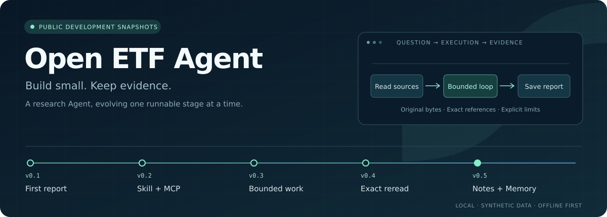

<p align="center"><strong>English</strong> | <a href="README.zh-CN.md">简体中文</a></p>

<p align="center">
  
</p>

<p align="center"><small>Historical overview through v0.10; the current v0.11 local PDF module is described below.</small></p>

<p align="center"><strong>Build a research Agent, one runnable module at a time. Start with a report you can open and trace to its sources.</strong></p>
<p align="center">
  <a href="#quickstart">Quickstart</a> ·
  <a href="#versions">Versions</a> ·
  <a href="#live-evidence">Real-call evidence</a> ·
  <a href="#live-entry">Restricted live runner</a> ·
  <a href="#architecture">Architecture</a> ·
  <a href="#reading">Articles and code</a> ·
  <a href="#roadmap">Roadmap</a>
</p>

<a id="english"></a>
## Open ETF Agent

A small research Agent that grows through independently runnable development snapshots. Reading, tool exchanges and source-linked file delivery come first; Skills, MCP, bounded cooperation, context management and Memory are added when needed. Each stage retains its own code and evidence so you can run it, compare it and see exactly what one new capability changes.

The introductory task compares **original synthetic documents**, not real funds. The small synthetic ETF Plugin introduced in v0.7 is also not a live financial-data service. Complete ETF research tools remain on the roadmap. This project does not execute trades or provide investment advice.

> **Start here:** clone `main`; there is no need to switch phase branches. It contains the latest qualified stable development code, **v0.11.0**, adding one local text-layer PDF module. The [fixed v0.11 source is `5f42c33`](https://github.com/hpoenixf/open-etf-agent/tree/5f42c33892d57ed05e8cd09cad48573e6901995b). Earlier `phase/v0.1`–`phase/v0.9` snapshots remain unchanged. Here, **stable means the bounded, provider-free Runtime and delivery checks described below**; it does not mean a formal release, model-quality certification, live-recovery qualification or production readiness. Original project code is [MIT-licensed](LICENSE); third-party licenses remain in force.

> **Looking for real model calls?** Read the [16 historical HTTP calls across v0.1–v0.5](#live-evidence), then the [separate live runner and its authorization requirements](#live-entry). Those records do not qualify v0.11 live recovery.

### What you can inspect

- **Actual file delivery:** reports, source versions, original text snapshots, hashes and save receipts, rather than only a “done” response.
- **One execution path:** new mechanisms join the existing Runtime / Tool Host instead of a separate demonstration engine.
- **Explicit evidence boundaries:** failures, fixes and unverified behavior are retained. Runtime correctness, model judgment and release status are separate claims.

Documentation defaults to English. Use the language links at the top of the main entry pages for Chinese. Historical evidence, internal Specs and some detailed design documents remain in their original language; they are not presented as English translations. Article links marked **Chinese original** have no complete English edition.

<a id="quickstart"></a>
## Quickstart

Requires **Node.js 26.8.1–26.x** and npm. Default examples need no model key. Dependency installation may access npm; the installed examples run offline.

The Node minimum reflects the APIs used. The narrow v0.11 install/build/CLI qualification ran on **26.11.1**. A successful 26.8.1 run was a user-supplied v0.6 observation, not a fresh v0.11 minimum-version test. See the [v0.6 filesystem-error maintenance record (Chinese)](docs/verification/v06-errno-maintenance.md) and [v0.7 toolchain record (Chinese)](docs/verification/v07-observations.md).

```sh
# main already contains the current stable development snapshot
git clone https://github.com/hpoenixf/open-etf-agent.git
cd open-etf-agent

npm ci --ignore-scripts --no-audit --no-fund
npm run build
npm test
npm run demo -- --case document-compare
```

`build` checks and copies native ESM and example data; it is not a TypeScript typecheck. The comparison keeps all four questions. Each Run creates a separate directory under `runs/` with `report.md`, `manifest.json` and `run.jsonl`. The CLI prints the actual directory. Inspect a Run with `node src/cli.mjs --observe runs/<run-id>`, replacing the placeholder with that ID.

**What does delivery look like?** This is a historical T1 excerpt from the [v0.5 synthetic receipts](https://github.com/hpoenixf/open-etf-agent/blob/05c0dd2dc550f4f7e5da034340ff5c3159768fcf/docs/verification/v05-demo-receipts.json), not a new execution. v0.6 adds immutable Artifact / Revision IDs and attachment identity; see its [delivery readback](https://github.com/hpoenixf/open-etf-agent/blob/7480b656b18192e6d6b44aab65255b970d58e6f8/docs/verification/v06-delivery-receipts.safe.json).

```json
{
  "caseId": "T1",
  "status": "completed",
  "semanticStatus": "unreviewed",
  "receipt": {
    "path": "report.md",
    "bytes": 933,
    "mediaType": "text/markdown; charset=utf-8"
  }
}
```

`completed` describes execution; `semanticStatus: unreviewed` leaves answer quality unreviewed. Full receipts also include hashes and actual source references. Tests reopen the files after the producing process exits.

<details>
<summary><strong>Try seven more kinds of example</strong></summary>

```sh
# A structured CSV attachment bound to an actual report revision
npm run demo -- --case artifact-table

# Read a method on demand, then acquire data from a real stdio fixture process
npm run demo -- --case skill-mcp

# Fixed reading workers and a one-level scripted Child are separate demonstrations
npm run demo -- --case batch-read
npm run demo -- --case fixture-child

# Change the query; inspect candidate-driven page reads and exact source rereading
npm run demo -- --case retrieve-reread --query "offline editing"
npm run demo -- --case retrieve-reread --query "Markdown"

# Keep derived notes separate from original text, which remains readable after compaction
npm run demo -- --case compact-and-reread

# Explicitly select a separate synthetic Memory library: save, revise and forget
npm run demo -- --case explicit-memory --memory-library runs/selected-synthetic-library
```

The Memory example uses synthetic intentions, not a real user's permanent preferences. `fixture-child` is not independent live-model reasoning. The default CLI explicitly refuses `--live` and `--case model-child`; it does not silently substitute a successful simulation.

The [fixed v0.6 instructions](https://github.com/hpoenixf/open-etf-agent/blob/7480b656b18192e6d6b44aab65255b970d58e6f8/README.md) retain all arguments and boundaries, including an English section.

</details>

### v0.11: one local PDF, one physical page, original bytes retained

The single new module is **local text-layer PDF input**, from [fixed source `5f42c33`](https://github.com/hpoenixf/open-etf-agent/tree/5f42c33892d57ed05e8cd09cad48573e6901995b). Choose a file outside the model, read a physical page through the existing Host/Result path, then reopen a cited report and the exact original PDF through the existing Artifact reader.

```sh
# Original synthetic PDF; no model key or external document needed
node dist/src/cli.mjs --case local-pdf --output runs/local-pdf
# Optional: explicitly select your own local text-layer PDF and physical page
node dist/src/cli.mjs --case local-pdf --pdf /path/to/selected.pdf --pdf-page 3 --output runs/selected-pdf
```

The second path is an operator placeholder, never a model tool argument. Limits: 1 MiB, 16 physical pages, bounded text and parser lifetime. Blank pages retain their physical numbers. `pdf2json@4.1.0` performs actual parsing; scripted Gateway actions are not model judgment. No OCR, visual/table interpretation, remote acquisition or active-PDF durable resume is offered. The parser process is **not a hostile-file security sandbox**.

[Qualification and preserved failures](openspec/changes/v011-local-pdf/evidence.md) distinguish the original Runtime regression, current maintenance checks and [fresh install/build/two-process byte readback](docs/verification/integrated-install-pdf.safe.json). The existing Session owner also receives the bounded hot-journal admission repair exposed by regression; it is necessary reliability maintenance, not a second new module or a PDF-resume promise. See [retained/simplified responsibilities](docs/evolution/v011-pdf-lineage.md).

### v0.10: one source selection, one result, one report and CSV

This completed Result / Reference module is **v0.10.0**, reproducible from [fixed source `ff5b927`](https://github.com/hpoenixf/open-etf-agent/tree/ff5b9273ef0d239e804f61792702cd2e94174be7). It replaces the old 0.10 reading-adapter proposal that lacked an independent consumer, and delivers the minimal increment originally planned for 1.1. It is not a v1.0 or v1.1 release, nor a second implementation of the same module.

```sh
node src/cli.mjs --case result-consumption --output runs/result-consumption
```

The example selects explicit rows from an immutable synthetic table and calculates using original values, units, currencies and dates. The next Gateway request, report and CSV consume the same calculation reference. An excluded tail row, inconsistent currency/date or unknown denominator does not produce an invented number or attachment, nor block independently valid prose. Arithmetic supplied with bare numbers does not gain source qualification.

The [source/delivery counterexamples](https://github.com/hpoenixf/open-etf-agent/blob/e442f600891be79625fc78751e2d9f39905920da/test/result-consumption-delivery.test.mjs), [333-case execution under the original 0.9.0 metadata](https://github.com/hpoenixf/open-etf-agent/blob/e442f600891be79625fc78751e2d9f39905920da/docs/verification/result-consumption-observations.safe.json) and [independent install/build/CLI/new-process byte readback](https://github.com/hpoenixf/open-etf-agent/blob/e442f600891be79625fc78751e2d9f39905920da/docs/verification/result-consumption-independent.safe.json) retain their actual execution scopes. Production Gateway encoding is tested with an injected offline transport. There are no new live-model calls or qualifications for financial semantics or real market data.

Assigning the version changed only three package/lock version fields: 123 other execution inputs and 95 locked dependencies were unchanged. The [fresh narrow install/build/CLI and exact-equivalence record](https://github.com/hpoenixf/open-etf-agent/blob/ff5b9273ef0d239e804f61792702cd2e94174be7/docs/verification/v010-numbering.safe.json) is separate; the historical 333 cases were not relabeled as a new 0.10.0 execution. Historical [coverage receipts](docs/verification/history/article-coverage-receipts-d943dd8452e4.json) bind the original 15 selected targets to the fixed source.

**Upgrade boundary: `tool-host@1` snapshots cannot resume or replay through the `tool-host@2` Runtime.** Finish old active Runs on their original version or isolate the old deployment before replacing it; retained outputs have independent readers. See the [upgrade contract and operational checklist](docs/upgrade-guide.md).

<details>
<summary>Earlier versions</summary>

### v0.9: another process continues the original Run

This stage adds a single-Run Worker using the original Session lease/fence and the same Runtime. It does not create a Task owner, queue or resident scheduling service.

```sh
node dist/src/session-cli.mjs submit --session runs/worker-demo --run original-example --case durable-publication
# submit has exited; work runs in a separate process
node dist/src/session-cli.mjs work --session runs/worker-demo --run original-example
node dist/src/session-cli.mjs publication --session runs/worker-demo --run original-example
```

`submit` only persists original identity, request, bindings, budget and deadline; it calls neither models nor tools. `work` executes the synthetic profile. The example's 30-second deadline starts at submission, not handoff. Another terminal `work` reads the original facts instead of researching again; use a fresh test directory and explicit Run ID for another demonstration.

SIGTERM/host stop is not user cancellation. Sealed work can continue under its original identity; unknown dispatched requests are not automatically resent. Already committed text survives later Run failure. Real synthetic tests exercise SQLite, independent processes and SIGTERM/SIGKILL; model actions remain scripted. Schedule, notifications, concurrent foreground chat and Web are excluded. See [Worker lineage (Chinese)](docs/evolution/v09-worker-lineage.md), [process tests](test/worker-process.test.mjs) and [observations (Chinese)](docs/verification/v09-observations.md).

### v0.6: read, download and verify over real HTTP

```sh
mkdir -p runs
node src/cli.mjs --case document-compare --output runs > runs/comparison.json
npm run evaluate -- --input runs/comparison.json

# Replace run-YOUR_ID with an actual Run directory from comparison.json
npm run serve -- --run runs/run-YOUR_ID
```

`serve` prints `http://127.0.0.1:PORT`; stop it with Ctrl-C. It reads only the selected Run's registered reports, original-text windows and attachments. Refresh/download does not call a model. Reads use strict IDs, not arbitrary paths; HTML/SVG is downloadable but not executed in the reader. This loopback-only service is not an authenticated public website.

`evaluate` starts and stops a short-lived local reader. It preserves the full T1–T4 denominator and uses real HTTP to check reports, complete original-source identity/bytes, and attachment uniqueness/bytes. It does not grade writing or resume unfinished Runs. To reproduce the old stage, check out [`7480b65`](https://github.com/hpoenixf/open-etf-agent/tree/7480b656b18192e6d6b44aab65255b970d58e6f8) separately; `main` remains the default entry.

### v0.7: trusted contributions and same-Run continuation

These existing entrypoints follow the [v0.7 contract/evidence (Chinese)](openspec/changes/v07-trusted-recovery/evidence.md). Optional checkpoints extend the existing Runtime; they do not introduce another recovery loop.

```sh
npm run session -- start --session runs/durable-example --case durable-report
# Replace run-YOUR_ID with the ID printed by start
npm run session -- inspect --session runs/durable-example --run run-YOUR_ID
npm run session -- resume --session runs/durable-example --run run-YOUR_ID
npm run session -- cancel --session runs/durable-example --run run-YOUR_ID

# Terminate a child, wait for exit, then continue under a different PID
node --test --test-concurrency=1 test/durable-runtime.test.mjs
```

Other original fixture profiles are `trusted-plugins`, `durable-child`, `durable-compaction` and `durable-memory`; use a separate session directory per example. Synthetic Memory intent is single-use: starting again is not renewed authorization. Resuming a terminal Run only reads existing results/files; that alone does not demonstrate interruption recovery.

- **Original boundaries remain:** question, Grant, provider/protocol/model and package bindings, absolute deadline and consumed shared budget are not reset. Sealed proposals do not resend model requests; committed results do not repeat tools. Dispatched work without a durable result stays unknown.
- **Existing owners verify their facts:** completed Child handoffs are fetched by identity; adopted notes retain the actual next-input identity; Memory checks original intent/revision without stealing an old writer lock; reports are read by original Artifact / Revision and bytes, not regenerated.
- **Bounded recovery:** SQLite lease/fence constrains database writes, not arbitrary external effects. Files and database writes are not one transaction. Legacy/unknown files require inspection, not blind replay or automatic deletion. Unknown active schemas are refused while immutable artifacts can still be read independently.
- **Trusted is not sandboxed:** a Plugin is explicitly imported local JavaScript with process privileges. Contributions are validated as a group; failed activation releases registered resources in reverse order. A selected module hash does not prove its dependency closure or captured variables. Explicit function configuration remains; models cannot install packages or enlarge authority.

The CLI resumes only its fixed synthetic profiles; it never swaps a real provider for a fixture. v0.7 added no real model requests and obtained no live-recovery qualification. Web Chat, background Worker, multitenancy and general external exactly-once effects were outside that stage.

### v0.8: commit and read back one answer block

v0.8 adds Publication only. Body text and file reports have separate receipts; a later Run failure does not erase an already committed body. Explicit replacement uses revision CAS; block identity and display position stay stable. Even an identical body must match the original binding before its receipt can be reused.

```sh
node dist/src/session-cli.mjs start --session runs/publication-demo --case durable-publication
# Replace run-YOUR_ID with the ID printed by start
node dist/src/session-cli.mjs publication --session runs/publication-demo --run run-YOUR_ID
node dist/src/session-cli.mjs publication-event --session runs/publication-demo --run run-YOUR_ID
node dist/src/session-cli.mjs publication-revisions --session runs/publication-demo --run run-YOUR_ID
```

This is a real local SQLite/process flow with synthetic replies and no model calls. It supports one root Run's body block and selected revision readback, not background Worker, Web Chat, SSE, global History or multitenancy. See [Publication lineage/boundaries (Chinese)](docs/evolution/v08-publication-lineage.md) and [observations (Chinese)](docs/verification/v08-observations.md).

</details>

<a id="versions"></a>
## Version history: ten fixed snapshots

Every link fixes the code, lockfile, examples and evidence from that stage. Recorded offline test counts describe those historical executions, not maturity scores, CI badges or model quality.

| Stage | Problem addressed | Added mechanism | Recorded offline evidence |
| --- | --- | --- | --- |
| [v0.1 · First report](https://github.com/hpoenixf/open-etf-agent/tree/f9370b81beef84199293120ee23d245bb0129553) | Make completion correspond to a real file | Runtime, Gateway, Tool Host, sources and save receipts | 23 |
| [v0.2 · Methods and tools](https://github.com/hpoenixf/open-etf-agent/tree/a79e89bf709d4a2245b5a8652882a591ba467519) | Bring external capabilities into the same tool chain | Explicit Skill, real stdio MCP, complete SSE reception | 49 |
| [v0.3 · Bounded cooperation](https://github.com/hpoenixf/open-etf-agent/tree/5d57314826447f024d878674b98057742b4ce4cd) | Keep parallel work within shared boundaries and budget | Hook, fixed workers, one-level fixture-child, read-only observation | 71 |
| [v0.4 · Originals beyond the input window](https://github.com/hpoenixf/open-etf-agent/tree/ecf6cb45b4062586614e83aed917c92d704cb63b) | Reduce input without losing the original version | ResultStore, Context, lexical retrieval, exact ResultRef rereading | 96 |
| [v0.5 · Notes and explicit Memory](https://github.com/hpoenixf/open-etf-agent/tree/05c0dd2dc550f4f7e5da034340ff5c3159768fcf) | Separate originals, derived notes and future preferences | Compaction; Memory save, revise and forget | 124 |
| [v0.6 · Delivery and reading](https://github.com/hpoenixf/open-etf-agent/tree/7480b656b18192e6d6b44aab65255b970d58e6f8) | Open, download and verify saved results by identity | Artifact / Revision, CSV attachments, loopback Reader, HTTP evaluate | 171 |
| [v0.7 · Trusted contributions and recovery](https://github.com/hpoenixf/open-etf-agent/tree/5f70dc0b4760ad70ef211f4823828ab2fee5c525) | Distinguish package loading or file reopening from same-Run recovery | Trusted Plugin, SQLite, lease/fence, sealed proposal/result-consumption checkpoints | [249](https://github.com/hpoenixf/open-etf-agent/blob/5f70dc0b4760ad70ef211f4823828ab2fee5c525/docs/verification/v07-observations.safe.json) |
| [v0.8 · Independent body commit](https://github.com/hpoenixf/open-etf-agent/tree/2c096ce47be2161f97531170af07ef255872f8b1) | Do not confuse Run termination or a file report with body publication | Single-block Publication, stable identity/position, revision CAS, original-receipt readback | [Full-suite receipt](docs/verification/v08-observations.safe.json) · [Historical output extract](docs/verification/v08-full-suite-extract.safe.json) |
| [v0.9 · Single-Run Worker](https://github.com/hpoenixf/open-etf-agent/tree/dad9c6e64f32c3d7579aea96613776b40917ec6d) | Keep original work after its submitting process exits | Separate submit/work, same Runtime and original lease/fence, durable terminal readback | [309-case combined execution](docs/verification/v09-combined-observations.safe.json) · [Historical delivery equivalence](docs/verification/v09-delivery-equivalence.safe.json) |
| [v0.10 · Consuming one result throughout](https://github.com/hpoenixf/open-etf-agent/tree/ff5b9273ef0d239e804f61792702cd2e94174be7) | Trace original selections and derived results to actual consumers | Source-bound calculation, next Gateway encoding, same-reference report/CSV, independent readback | [Original 333-case execution](docs/verification/result-consumption-observations.safe.json) · [Narrow version qualification](docs/verification/v010-numbering.safe.json) · [Fresh receipts for 15 original targets](docs/verification/history/article-coverage-receipts-d943dd8452e4.json) |
| [v0.11 · Local PDF](https://github.com/hpoenixf/open-etf-agent/tree/5f42c33892d57ed05e8cd09cad48573e6901995b) | Select a physical page while retaining the original file | Bounded text extraction, original Result, cited report and exact PDF attachment | [Qualification and preserved failures](openspec/changes/v011-local-pdf/evidence.md) · [Fresh independent delivery](docs/verification/integrated-install-pdf.safe.json) |

**v0.2 maintenance:** the original snapshot is historical. [Maintenance snapshot `a10d4f1`](https://github.com/hpoenixf/open-etf-agent/tree/a10d4f1bd1ecc39224272156221fe29792b64094) corrects report wording about unread pages. Use `maintenance/v0.2-source-boundary` specifically for the corrected v0.2 experience; the original snapshot was not rewritten.

<a id="architecture"></a>
## Architecture: keep responsibilities visible

```text
User question → Runtime ⇄ Gateway
                  │        Context organizes the next request
                  ▼
               Tool Host → read / calculate / save
                  │
                  ├─ ResultStore: acquired originals, versions and exact references
                  ├─ Working notes: source-grounded derived notes
                  └─ Report / Artifact: immutable revisions, attachments, references, receipts
                                   └─ Loopback Reader / evaluate: actual HTTP byte readback

Explicit Memory library → authorized save / revise / forget → later input
```

| Owner | Responsibility | Boundary |
| --- | --- | --- |
| **Runtime / Gateway** | Bounded model–tool loop, request encoding, complete response reception | Partial JSON or network EOF is not a complete tool call |
| **Tool Host** | Tool bindings, argument/authority validation, execution and receipts | Models cannot supply arbitrary host file paths |
| **ResultStore / Context** | Immutable originals and a bounded working view for the next request | Working views do not rewrite originals; retrieval hits are not acquired pages |
| **Compaction / Memory** | Derived notes, explicit library/write intent, future input excluding forgotten content | Summaries do not become originals; temporary requests do not become long-term preferences |
| **Trusted Plugin (v0.7)** | Explicit contributions, identity bindings, atomic activation/reverse release | Not a sandbox; no model-driven installation or privilege expansion |
| **Publication (v0.8)** | Independent body, revisions and current delivery position within the original Session transaction | Does not replace Artifact, delete committed text on Run failure or add an executor |
| **Single-Run Worker (v0.9)** | Drive an explicit original Run in another process; read its authoritative terminal state | Does not duplicate lease/fence, equate host stop with user cancellation, or add a queue/Scheduler |
| **SQLite / Checkpoint (v0.7)** | Persist request, budget, proposal, results and consumption position at existing Runtime boundaries | No second execution path, retry of unknown effects or external exactly-once guarantee |

Start in [source](src). The [evolution evidence index (Chinese)](docs/evolution/evidence-index.md) retains design motivations and actual failures.

## Evidence and its limits

The [v0.1–v0.11 verification index](docs/verification/README.md) links observations, receipts, provenance and qualification by stage. New numbers do not overwrite historical evidence.

<details>
<summary><strong>Recorded qualification and maintenance history</strong></summary>

- **v0.6:** independent installation, 171 offline tests, build, eight example types, eleven post-exit report readbacks and T1–T4 HTTP checks. The later [filesystem-error maintenance fix (Chinese)](docs/verification/v06-errno-maintenance.md) lets wrapped file-exists errors reach original identity/byte checks without swallowing unknown errors, cancellation or null/undefined causes. Its 184-case run on Node 26.11.1 is a separate maintenance result, not a rewrite of the fixed stage.
- **v0.7:** 249 tests on frozen inputs under Node 26.11.1, including twelve real-process interruption/cancellation/cross-restart deadline scenarios and independent recovery counterexamples; independent locked install/build, five durable profiles, nine post-exit report receipts, HTTP T1–T4 and retained v0.6 artifact readback. The Evidence Kit records six structural checks and provider-free completion; structure checks are not execution certification. [Observations (Chinese)](docs/verification/v07-observations.md), [frozen inputs](docs/verification/v07-candidate-inputs.json), [delivery receipts](docs/verification/v07-delivery-receipts.safe.json).
- **v0.8:** 286 provider-free checks plus independent install/build/cross-process CLI readback. Version promotion then changed three version fields across two package-metadata files; 117 behavior/test inputs and 95 dependencies stayed unchanged. Independent install/build/version checks were repeated, not the entire suite. The original [`fullSuite`](docs/verification/v08-observations.safe.json) records command, exit status, duration and counts. The [historical output extract](docs/verification/v08-full-suite-extract.safe.json) checks retained output and is not a new run. [Both exact input summaries and provenance (Chinese)](docs/verification/v08-observations.md).
- **v0.9:** the initial Worker combination recorded 305 cases. After existing CI/lineage maintenance was integrated, a new 124-input combination ran all 309 cases with no failures, skips or cancellations. The nineteen Worker tests and implementation bytes stayed unchanged; coverage-checker maintenance and its tests changed. Original install/eight-process CLI evidence is retained with exact equivalence of 58 delivery inputs and 55 build outputs, not relabeled as another installation. [Combined receipt](docs/verification/v09-combined-observations.safe.json), [frozen inputs](docs/verification/v09-combined-inputs.json), [delivery equivalence](docs/verification/v09-delivery-equivalence.safe.json).

These stages added no real model calls. Real fixture processes, MCP exchanges and file readback do not establish model understanding, source selection or summary quality. A fixture process is not a sandbox for arbitrary third-party code; MCP initialization cancellation has not been specifically verified. Forgetting affects future Memory input, not old reports. Reopening a file does not prove recovery; inspect the real-process tests. The scope remains local, single-user and path-bounded, not a production financial service, multitenancy, trading, background scheduling or a general vector platform.

</details>

<a id="live-evidence"></a>
### Real calls: 16 HTTP requests, not 16 capability certifications

The [first v0.1–v0.5 live-call record, pinned at `d075068`](https://github.com/hpoenixf/open-etf-agent/blob/d075068ac99a6c798d012c46bff4fe0c33eb9979/docs/verification/live-v01-v05-first-batch.md) used each stage's original Runtime / Gateway with one original synthetic question per stage: **16 authenticated real HTTP calls and 16 HTTP 200 responses**. v0.1 recorded a real refusal and no report. v0.2–v0.5 reports were read back and hashed. HTTP 200, a saved report or a successful subscription call alone is not task success.

**Model quality remains unreviewed; `semanticStatus` remains `unreviewed`.** Small historical manual wording observations are retained but are not a complete independent semantic evaluation. The goal was Runtime correctness. Untouched Skill, MCP, Child, Memory and Compaction paths did not gain live coverage from that batch; nor did v0.7 SQLite/recovery.

<a id="live-entry"></a>
### Restricted live runner: separate from the demo CLI

`npm run demo -- --live` refuses by design. This does not mean real calls have never been made, and replacing the argument with a fixture does not bypass authorization. The separate `scripts/live-validate.mjs` runner has [fixed-version instructions](https://github.com/hpoenixf/open-etf-agent/blob/d075068ac99a6c798d012c46bff4fe0c33eb9979/docs/live-validation.md) and [current instructions](docs/live-validation.md), retained in their original language.

It requires **your own provider, synthetic-data and cost authorization**, an explicit fixed version, private configuration and a budget ledger shared across versions. Unknown outcomes stop execution; they are not automatically retried. Other operators' credentials or budgets are not inherited. Quickstart/demo/session commands above are offline examples. v0.11 adds no new model requests; historical calls are not current live-recovery qualification.

## License

Original code and accompanying original documentation are [MIT](LICENSE), Copyright © 2026 Huang Pengfei. Third-party dependencies, the accompanying Evidence Kit and NOTICE retain their own licenses and attribution. This license does not cover external private source, manuscripts or other outside content. `private: true` prevents accidental npm publication; it does not restrict MIT rights.

Historical candidate manifests retain the inputs frozen for their own qualification. Their `candidate` / `prepared-only` wording describes the pre-publication state, not current remote availability. Publication preserved main's MIT LICENSE bytes and integrated this homepage; historical manifests do not claim that later documentation edits have identical hashes. Frozen executable/test/fixture/lockfile identities and original maintenance records remain separate from these reader-facing changes.

[v0.7 recovery evidence (Chinese)](openspec/changes/v07-trusted-recovery/evidence.md) · [v0.6 observations (Chinese)](docs/verification/v06-observations.md) · [v0.6 original Spec/evidence (Chinese)](openspec/changes/v06-artifact-reader/evidence.md) · [v0.6 fixed inputs](https://github.com/hpoenixf/open-etf-agent/blob/7480b656b18192e6d6b44aab65255b970d58e6f8/docs/verification/v06-candidate-inputs.json)

[v0.5 failures/fixes (Chinese)](https://github.com/hpoenixf/open-etf-agent/blob/05c0dd2dc550f4f7e5da034340ff5c3159768fcf/docs/verification/v05-observations.md) · [artifact provenance/hashes](https://github.com/hpoenixf/open-etf-agent/blob/05c0dd2dc550f4f7e5da034340ff5c3159768fcf/docs/verification/v05-evidence-provenance.json) · [SDK selection/compatibility (Chinese)](https://github.com/hpoenixf/open-etf-agent/blob/05c0dd2dc550f4f7e5da034340ff5c3159768fcf/docs/dependencies/sdk-selection.md)

<a id="reading"></a>
## Articles and code

See the [articles and code guide](docs/articles-and-code.md) for the complete mapping, runnable cases and evidence boundaries.

<a id="roadmap"></a>
## Roadmap: planned is not shipped

v0.9's single-Run Worker is a fixed stage. The completed Result / Reference path is now v0.10, with its version identity independently checked. Numbering does not expand scope; subsequent modules follow the amended original plan.

| Stage | Direction |
| --- | --- |
| **v0.10 — delivered** | Source selection → calculation → next Gateway encoding → same-reference report/CSV; the duplicate reading-adapter proposal is retired |
| **v0.11 — local PDF** | Text-layer input through existing Result/Artifact consumers; no OCR, visual parsing or durable active-PDF recovery |
| **Later 0.x** | Assess Web acquisition, isolated Python and richer PDF capabilities separately: one module per version |
| **v1.0 / v2.0** | Stability qualification milestones for completed modules, not new-feature bundles; see the [amended roadmap](docs/plan/v1-to-v2.md) |

Web acquisition is an unnumbered external-input candidate on the original roadmap. The Web reading UI is a later output consumer; they are not interchangeable. The original 1.1 Result-consumption increment is already delivered by v0.10 and is not scheduled twice. Planned 1.3/1.5 extend existing Memory recall and Child respectively. Missing prerequisites delay a phase; they are not permission to add another module incidentally.

[PR #1 original proposal](https://github.com/hpoenixf/open-etf-agent/pull/1) · [original plan/acceptance contract (Chinese)](https://github.com/hpoenixf/open-etf-agent/blob/c390eb2dd951b53b1dab2d64a9cd72d216fde8dc/docs/plan/README.md) · [capability matrix (Chinese)](https://github.com/hpoenixf/open-etf-agent/blob/c390eb2dd951b53b1dab2d64a9cd72d216fde8dc/docs/plan/05-coverage-matrix.md)

The original proposal remains a historical design record. Amendments favor one real module per version, CLI/API first, minimal dependencies/configuration and careful public extraction of established ETF Agent responsibilities. Larger candidates remain WIP rather than becoming a bundled release merely because code exists. The version table, not the roadmap, lists delivered code.

### Feedback and contributions

See the [repository maintenance acceptance requirements](docs/verification/README.md#repository-maintenance).

Open an [issue](https://github.com/hpoenixf/open-etf-agent/issues) with the **stage/commit, Node version, minimal reproduction, expected behavior and actual result**. Do not include keys, private material, databases, real holdings or unsanitized logs. For improvements, explain the concrete problem and how the change can be verified.

---

<p align="center">Build small. Keep evidence.<br /><a href="README.zh-CN.md">阅读简体中文版</a></p>
