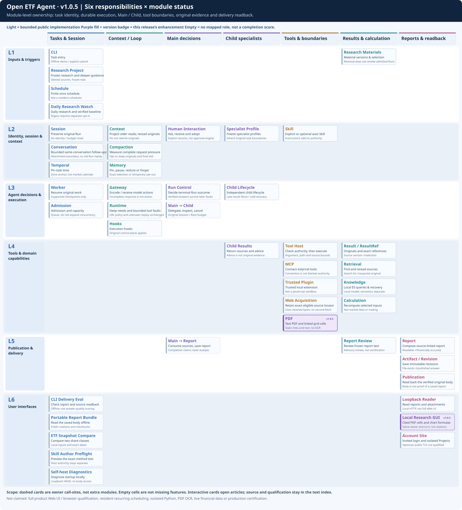
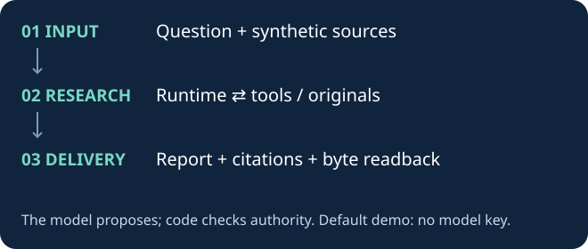

<p align="center"><strong>English</strong> | <a href="README.zh-CN.md">简体中文</a></p>

# Open ETF Agent

<p align="center">
  <a href="https://github.com/hpoenixf/open-etf-agent/actions/workflows/verify.yml?query=branch%3Amain"></a>
  <a href="https://github.com/hpoenixf/open-etf-agent/releases/latest"></a>
  <a href="https://github.com/hpoenixf/open-etf-agent/blob/main/LICENSE"></a>
  <br />
  <a href="https://github.com/hpoenixf/open-etf-agent/blob/main/package.json"></a>
  <a href="https://github.com/hpoenixf/open-etf-agent/blob/main/package.json"></a>
  <a href="https://github.com/hpoenixf/open-etf-agent/stargazers"></a>
</p>
<p align="center">
  <a href="https://hub.xerj.org/contributors/hpoenixf"></a><br />
  <small>The v0.9 standalone CLI Worker implementation was selected for <a href="https://hub.xerj.org/corpus/hpoenixf--open-etf-agent">XERJ Corpus Hub</a>.</small>
</p>


**Read an Agent architecture article. Run its corresponding implementation. Open a report and trace it back to sources, fixed code and evidence.**

A runnable learning project for Agent developers. Start with an offline report over synthetic documents, then explore the modules and evidence. No model key required; not a live fund-research, trading or investment-advice service.

**[Quickstart](#quickstart) · [Read all articles](https://hpoenixf.com/eff-agent-article/en/open-etf-agent)**

[Latest modules](#versions) · [Architecture](#architecture) · [Scope and safety](#scope) · [Full documentation](#documentation) · [Contribute](#feedback-and-contributions)

<!-- module-map:start -->
<a id="module-map"></a>
## What is here, and how far does it go?

[](docs/assets/module-map.svg)

[Interactive module map: open articles by card](https://hpoenixf.com/eff-agent-article/en/open-etf-agent#module-map) · [Open full-size module matrix (zoomable)](docs/assets/module-map.svg) · [Per-module text and source index](docs/module-status.md)

GitHub treats embedded SVG as one image, so its cards are not individually clickable here. Each module name below opens its corresponding article.

| Layer | Modules and capabilities → articles |
| --- | --- |
| L1 Inputs & triggers | [CLI](https://hpoenixf.com/eff-agent-article/en/articles/agent-in-15-minutes) · [Research Project](https://hpoenixf.com/eff-agent-article/en/articles/open-etf-agent-research-project-workshop) · [Research Materials](https://hpoenixf.com/eff-agent-article/en/articles/agent-research-assets-identity-version-lifecycle) · [Schedule](https://hpoenixf.com/eff-agent-article/en/articles/agent-autonomous-scheduled-research) · [Daily Research Watch](https://hpoenixf.com/eff-agent-article/en/articles/agent-autonomous-scheduled-research) |
| L2 Identity, session & context | [Session](https://hpoenixf.com/eff-agent-article/en/articles/agent-task-session-run-worker-schedule) · [Conversation](https://hpoenixf.com/eff-agent-article/en/articles/agent-conversation-admission-task-continuation) · [Temporal](https://hpoenixf.com/eff-agent-article/en/articles/agent-temporal-semantics-market-calendar) · [Context](https://hpoenixf.com/eff-agent-article/en/articles/agent-context-governance-actions) · [Compaction](https://hpoenixf.com/eff-agent-article/en/articles/agent-main-run-context-compaction) · [Memory](https://hpoenixf.com/eff-agent-article/en/articles/026-agent-memory-forget-durable-effects) · [Human Interaction](https://hpoenixf.com/eff-agent-article/en/articles/agent-durable-human-interaction-response-adoption) · [Specialist Profile](https://hpoenixf.com/eff-agent-article/en/articles/agent-custom-expert-from-prompt-to-recovery) · [Skill](https://hpoenixf.com/eff-agent-article/en/articles/agent-skill-from-markdown-to-callable-research) |
| L3 Agent decisions & execution | [Worker](https://hpoenixf.com/eff-agent-article/en/articles/open-etf-agent-v010-system-design) · [Admission](https://hpoenixf.com/eff-agent-article/en/articles/agent-provider-admission-capacity-lease) · [Gateway](https://hpoenixf.com/eff-agent-article/en/articles/agent-provider-architecture-and-admission) · [Runtime](https://hpoenixf.com/eff-agent-article/en/articles/etf-agent-model-harness-research-loop) · [Hooks](https://hpoenixf.com/eff-agent-article/en/articles/agent-multi-ecosystem-hook-execution) · [Run Control](https://hpoenixf.com/eff-agent-article/en/articles/agent-veto-authority-and-run-termination) · [Main → Child](https://hpoenixf.com/eff-agent-article/en/articles/agent-subagent-context-specialization) · [Child Lifecycle](https://hpoenixf.com/eff-agent-article/en/articles/agent-subagent-context-specialization) |
| L4 Tools & domain capabilities | [Tool Host](https://hpoenixf.com/eff-agent-article/en/articles/agent-tool-lifecycle-and-model-input) · [MCP](https://hpoenixf.com/eff-agent-article/en/articles/mcp-host-from-discovery-to-consumption) · [Trusted Plugin](https://hpoenixf.com/eff-agent-article/en/articles/020-agent-extension-host-smartphone) · [Web Acquisition](https://hpoenixf.com/eff-agent-article/en/articles/021-agent-web-research-from-search-to-deep-reading) · [PDF](https://hpoenixf.com/eff-agent-article/en/articles/024-agent-pdf-from-text-to-evidence) · [Result / ResultRef](https://hpoenixf.com/eff-agent-article/en/articles/tool-results-outside-model-context) · [Retrieval](https://hpoenixf.com/eff-agent-article/en/articles/agent-knowledge-retrieval-end-to-end) · [Knowledge](https://hpoenixf.com/eff-agent-article/en/articles/agent-knowledge-retrieval-end-to-end) · [Calculation](https://hpoenixf.com/eff-agent-article/en/articles/open-etf-agent-v010-system-design) · [Child Results](https://hpoenixf.com/eff-agent-article/en/articles/agent-subagent-contribution-evidence) |
| L5 Publication & delivery | [Main → Report](https://hpoenixf.com/eff-agent-article/en/articles/open-etf-agent-v01-first-readable-report) · [Report](https://hpoenixf.com/eff-agent-article/en/articles/open-etf-agent-v01-first-readable-report) · [Artifact / Revision](https://hpoenixf.com/eff-agent-article/en/articles/agent-artifact-version-access-sharing) · [Publication](https://hpoenixf.com/eff-agent-article/en/articles/019-agent-answer-publication) · [Report Review](https://hpoenixf.com/eff-agent-article/en/articles/open-etf-agent-report-review-workshop) |
| L6 User interfaces | [Loopback Reader](https://hpoenixf.com/eff-agent-article/en/articles/open-etf-agent-v010-system-design) · [Local Research GUI](https://hpoenixf.com/eff-agent-article/en/articles/agent-conversation-admission-task-continuation) · [Account Site](https://hpoenixf.com/eff-agent-article/en/articles/open-etf-agent-v010-system-design) · [CLI Delivery Eval](https://hpoenixf.com/eff-agent-article/en/articles/open-etf-agent-v01-first-readable-report) · [Portable Report Bundle](https://hpoenixf.com/eff-agent-article/en/articles/open-etf-agent-v01-first-readable-report) · [ETF Snapshot Compare](https://hpoenixf.com/eff-agent-article/en/articles/open-etf-agent-v01-first-readable-report) · [Skill Author Preflight](https://hpoenixf.com/eff-agent-article/en/articles/agent-skill-from-markdown-to-callable-research) · [Self-host Diagnostics](https://hpoenixf.com/eff-agent-article/en/articles/open-etf-agent-v010-system-design) |

**Current map: v1.0.3** · [Modules, source & evidence](docs/module-status.md) · [Six-layer article (Chinese original)](https://github.com/hpoenixf/eff-agent-article/blob/249f0b866f9446f33b57f186fbc6d35b5d82c119/articles/open-etf-agent-v010-system-design.md)

Article links are reading navigation, not implementation parity or coverage qualification. This maps public implementation, not completion percentages. Live-model evidence qualifies only the paths in [version records](docs/verification/README.md), not financial accuracy, production or browser experience.
<!-- module-map:end -->

<a id="reading"></a>
## Start with a question, not a version number

<details>
<summary>Choose a reading and hands-on path</summary>

| What you want to do | Read / run next |
| --- | --- |
| Understand one Agent workflow | [Agent in fifteen minutes](https://hpoenixf.com/eff-agent-article/en/articles/agent-in-15-minutes) → [Execution identities](https://hpoenixf.com/eff-agent-article/en/articles/agent-task-session-run-worker-schedule) |
| Research your own documents | [Research project workshop](https://hpoenixf.com/eff-agent-article/en/articles/open-etf-agent-research-project-workshop) → [Project CLI](docs/research-project.md) |
| Gather evidence, delegate and review | [Report review workshop](https://hpoenixf.com/eff-agent-article/en/articles/open-etf-agent-report-review-workshop) → [Specialist profiles](docs/v027-specialist-profiles.md) · [Report review](docs/report-review.md) |
| Check what an article actually implements | [Fixed-version coverage](docs/articles-and-code.md) · [All articles](https://hpoenixf.com/eff-agent-article/en/open-etf-agent) |

Articles can describe a broader system than the public module. Coverage records qualify historical fixed versions, not the full capability set of latest main.

</details>

**Recently updated reading**

<!-- Recent reading source: hpoenixf/eff-agent-article@8ed23b7c67c52b15b2696bcdb4580d6df12e11ab README.en.md; Chinese-source Git history order, translated editions are not separate entries. -->
[From First Question to Readback: Research You Can Reopen in Open ETF Agent](https://hpoenixf.com/eff-agent-article/en/articles/open-etf-agent-verify-and-reopen-research) · [Publication: Why Answers Need Their Own Delivery System](https://hpoenixf.com/eff-agent-article/en/articles/019-agent-answer-publication) · [Web Research: From Search to Deep Reading](https://hpoenixf.com/eff-agent-article/en/articles/021-agent-web-research-from-search-to-deep-reading)

<a id="quickstart"></a>
## Quickstart

Requires **Node.js 26.8.1–26.x** and npm. Default examples need no model key. Dependency installation may access npm; the installed examples run offline.

```sh
# Clone main for current development; use a release tag for a fixed version
git clone https://github.com/hpoenixf/open-etf-agent.git
cd open-etf-agent

npm ci --ignore-scripts --no-audit --no-fund
npm run build
npm test
npm run demo -- --case document-compare
```

`build` checks and copies native ESM and example data; it is not a TypeScript typecheck. The comparison keeps all four questions. Each Run creates a separate directory under `runs/` with `report.md`, `manifest.json` and `run.jsonl`. The CLI prints the actual directory. Inspect a Run with `node src/cli.mjs --observe runs/<run-id>`, replacing the placeholder with that ID.

[Try seven more mechanism examples →](docs/module-guide.md#try-seven-more-kinds-of-example)

**What should you inspect?** Open `report.md` in the directory printed by the CLI, then trace sources and execution through `manifest.json` and the observe command. A readable report, a completed task and a correct conclusion are different outcomes.

**Ready to use a real model?** Do not add `--live` to the demo command. Use the [research project entry](docs/research-project.md): first import and submit without model calls, then configure your authorized provider and budget. The [report review entry](docs/report-review.md) also distinguishes fixture lifecycle runs from real model judgment.


[Offline evaluation: run delivery checks and compare baselines from the CLI](docs/evaluation-cli.md)

<a id="versions"></a>
<a id="latest-three-modules"></a>
## Releases and development status

**[v0.70.0 · Self-host deployment diagnosis](https://github.com/hpoenixf/open-etf-agent/commit/7b7e3a586c8bae962359654247680a2fe3db3e54).** Separate missing dependencies, runtime version, configuration, directory access and the local listener. [Scope and verification](docs/verification/v070-self-host-diagnostics.md)

**[v0.69.0 · Skill author preflight](https://github.com/hpoenixf/open-etf-agent/commit/1e9f4d300b6dbef5df5ea2262891020acb4bb193).** Validate and preview a Skill, then run a synthetic authoring case. [Scope and verification](docs/verification/v069-skill-author-preflight.md)

**[v0.68.0 · ETF snapshot comparison](https://github.com/hpoenixf/open-etf-agent/commit/0d46ab558e64328cc860319e8bc2b995ae5ea4e8).** Recompute fees, holdings and sector overlap, and same-basis returns from local snapshots. [Scope and verification](docs/verification/v068-etf-snapshot-comparison.md)

| Recent version / status | What it enables | Usage and boundaries |
| --- | --- | --- |
| [v0.70.0 · Self-host deployment diagnosis](https://github.com/hpoenixf/open-etf-agent/commit/7b7e3a586c8bae962359654247680a2fe3db3e54) | Separate missing dependencies, runtime version, configuration, directory access and the local listener | [Scope and verification](docs/verification/v070-self-host-diagnostics.md) |
| [v0.69.0 · Skill author preflight](https://github.com/hpoenixf/open-etf-agent/commit/1e9f4d300b6dbef5df5ea2262891020acb4bb193) | Validate and preview a Skill, then run a synthetic authoring case | [Scope and verification](docs/verification/v069-skill-author-preflight.md) |
| [v0.68.0 · ETF snapshot comparison](https://github.com/hpoenixf/open-etf-agent/commit/0d46ab558e64328cc860319e8bc2b995ae5ea4e8) | Recompute fees, holdings and sector overlap, and same-basis returns from local snapshots | [Scope and verification](docs/verification/v068-etf-snapshot-comparison.md) |

[All fixed versions and commands](docs/module-guide.md#versions) · [Version lineage](versions.json) · [All releases](https://github.com/hpoenixf/open-etf-agent/releases) · [Verification records](docs/verification/README.md)

<details>
<summary>Earlier versions</summary>

**[v0.67.0 · Offline research report bundle](https://github.com/hpoenixf/open-etf-agent/commit/3e3fa36832f721957c811f111f87d1b50d2918f7).** Copy a published report, keep public locations, and verify every file offline. [Scope and verification](docs/verification/v067-offline-report-bundle.md)

**[v0.51.0 · Offline delivery evaluation](https://github.com/hpoenixf/open-etf-agent/commit/599c512e5220a7d474ad1a021faa87897157ff36).** Four synthetic cases verify report and source readback over HTTP and correlate each case with its local runtime timeline. No model calls or GUI changes. [Scope and verification](docs/verification/v051-offline-delivery-evaluation.md)

**[v0.50.0 · Daily Brief and complete scheduled email](https://github.com/hpoenixf/open-etf-agent/releases/tag/v0.50.0).** Daily watches use Beijing-local news windows. The owner can choose a complete daily digest or two separate full-report watch emails after consent, without rerunning research. Email is off by default. [Scope and verification](docs/verification/v050-daily-brief-and-complete-email.md)

**[v0.49.0 · Research runtime reliability](https://github.com/hpoenixf/open-etf-agent/releases/tag/v0.49.0).** Deep research can keep a run-scoped working brief. Proved local URL refusals and settled optional page timeouts need not erase the research. An admissible URL still has to pass the original checks. Owner telemetry is optional and off by default. [Scope and verification](docs/verification/v049-research-runtime-reliability.md)

**[v0.48.0 · Verified web sources for saved answers](https://github.com/hpoenixf/open-etf-agent/releases/tag/v0.48.0).** Reopen the original webpage links and verified retained excerpts for the exact saved answer. Missing or unverified sources are omitted without changing the saved answer. Isolated browser staging verified readback after refresh without a new model request. [Scope and verification](docs/verification/v048-verified-web-sources.md)

**[v0.46.1 · Compact research workbench](https://github.com/hpoenixf/open-etf-agent/releases/tag/v0.46.1).** The bottom composer stays in view, History and Sources fold independently, and Daily Watch opens from a capsule. Stop shares the Send slot. Staging covered desktop and narrow viewports, without a new paid cohort. [Scope and verification](docs/verification/v0461-compact-workbench.md)

**[v0.46.0 · Deep research evidence milestones](https://github.com/hpoenixf/open-etf-agent/releases/tag/v0.46.0).** Deep research distinguishes original entries actually read, checks that returned no readable source, and an answer saved and read back. In isolated staging, all ten fixed tasks completed and their exact answers read back. The browser check covered one explicit Deep turn. This does not verify the conclusions or change hosted production. [Scope and verification](docs/verification/v046-deep-evidence-milestones.md) · [PR #26](https://github.com/hpoenixf/open-etf-agent/pull/26)

**[v0.45.0 · Research modes and a compact composer](https://github.com/hpoenixf/open-etf-agent/releases/tag/v0.45.0).** Choose Auto, Standard or Deep in the composer, or select the Financial Chart Skill explicitly. Thinking effort is a separate preview for the explicitly enabled OpenCode Go GLM-5.3-Flash route; Default sends no override. In the fixed isolated-staging cohort, Runtime delivery and History readback passed 10/10; the stricter release checks passed 9/10. Hosted production was not changed. [Scope and verification](docs/verification/v045-research-intent.md)

**[v0.44.0 · Research workspace GUI](https://github.com/hpoenixf/open-etf-agent/releases/tag/v0.44.0).** Saved reports render as Markdown. The Financial Chart Skill uses verified evidence from the same Run and preserves missing observations. Default local startup stays offline. Isolated staging covered desktop and a narrow viewport, not browser PDF or a physical phone; hosted production was unchanged. [Scope and verification](docs/verification/v044-gui-candidate.md)

**[v0.43.0 · Isolated account workspace](https://github.com/hpoenixf/open-etf-agent/releases/tag/v0.43.0).** Opt in to invitation-only sign-in with a separate Project for each account. Default startup remains offline. The installer was verified in isolation; public TLS and live data migration were not qualified. [Setup and scope](docs/verification/v043-account-site.md)

| Recent version / status | What it enables | Usage and boundaries |
| --- | --- | --- |
| [v0.45.0 · Research modes and a compact composer](https://github.com/hpoenixf/open-etf-agent/releases/tag/v0.45.0) | Three research modes, a Chart Skill picker, and an optional thinking effort preview | [Scope and verification](docs/verification/v045-research-intent.md) |
| [v0.44.0 · Research workspace GUI](https://github.com/hpoenixf/open-etf-agent/releases/tag/v0.44.0) | Markdown reports and saved same-Run charts; missing observations stay missing | [Scope and verification](docs/verification/v044-gui-candidate.md) |
| [v0.43.0 · Isolated account workspace](https://github.com/hpoenixf/open-etf-agent/releases/tag/v0.43.0) | Invite-only login and isolated Projects; public deployment not qualified | [Setup and scope](docs/verification/v043-account-site.md) |

**[v0.42.0 · Daily research and an optional owner digest](https://github.com/hpoenixf/open-etf-agent/releases/tag/v0.42.0).** Track an unchanged question against the last verified answer. A changed question starts a new baseline. Delivery remains opt-in; external email was not qualified. [Usage](docs/local-gui-daily-watch.md) · [Runtime verification](docs/verification/v042-runtime-qualification.md)

**[v0.41.0 · Owner research workspace](https://github.com/hpoenixf/open-etf-agent/releases/tag/v0.41.0).** Bounded follow-ups, observable research progress, and opt-in public research tools. Default startup remains offline. Per-question text PDF support is implemented, but browser PDF acceptance was deferred. [Owner setup](docs/local-gui-live.md) · [Scope and verification](docs/verification/v041-release-candidate.md)

**[v0.39.0 · Local research GUI preview](https://github.com/hpoenixf/open-etf-agent/releases/tag/v0.39.0).** Open the browser workspace with `npm run gui -- --project ./test-output/local-gui`. The workspace uses two bundled synthetic ETF sources and saves conversations, reports and citations locally. [Setup and scope](docs/local-gui.md) · [Verification](docs/verification/v039-release.md)

**[v0.38.0 · Wind ETF daily closes](https://github.com/hpoenixf/open-etf-agent/releases/tag/v0.38.0):** Opt in to fetch unadjusted daily exchange closes for one ETF. Default research does not contact Wind. [Usage](docs/wind-fund-mcp.md) · [Evidence and limits](docs/verification/v038-release.md).

**[v0.37.0 · Main context compaction](https://github.com/hpoenixf/open-etf-agent/releases/tag/v0.37.0):** Check pressure on the full Gateway request; skip ineffective repeats and reserve the final model slot for delivery. [Usage](docs/project-context.md) · [Evidence and limits](docs/verification/v037-release.md).

**[v0.36.1 maintenance](https://github.com/hpoenixf/open-etf-agent/releases/tag/v0.36.1).** Main compaction excludes settled tool groups that contain typed Project Memory from new and reused summaries. The original typed data still passes through the existing pre-dispatch checks. [Verification and limits](docs/verification/v0361-maintenance.md)

**[v0.36.0 · Project Memory lifecycle](https://github.com/hpoenixf/open-etf-agent/releases/tag/v0.36.0):** Pin, pause, restore or forget project Memory explicitly. A task can select exact revisions or opt out, and queued typed Memory is rechecked before dispatch. The frozen synthetic live cohort passed 10/10. [Evidence and limits](docs/verification/v036-release.md).

**[v0.35.0 · Native PDF table evidence](https://github.com/hpoenixf/open-etf-agent/releases/tag/v0.35.0):** Cite exact row and column cells from supported native PDF tables and read back the original page from a saved report. Ambiguous layouts retain plain text without guessing cells. The frozen live cohort passed 10/10. [Evidence and limits](docs/verification/v035-release.md).

**[v0.34.0 · A14 context projection](https://github.com/hpoenixf/open-etf-agent/releases/tag/v0.34.0):** An opt-in working-set policy projects eligible older tool results to references while preserving authorized original rereads. The original independently reviewed cohort remains 9/10; targeted Q09 and projection checks do not revise it. [Usage](docs/context-fitting.md) · [Evidence and limits](docs/verification/v034-release.md).

**[v0.33.0 · Material lifecycle](https://github.com/hpoenixf/open-etf-agent/releases/tag/v0.33.0):** A17 adds project-local versioned materials, idempotent import, replacement, removal and explicit recovery; admitted tasks retain exact source snapshots. The first live cohort remains 8/10; the prospective cohort is operator-reviewed 9/10, not independent content acceptance. Two requests retain unknown billing. [Evidence and limits](docs/verification/v033-release.md).

**[v0.32.0 · Local dynamic Knowledge](https://github.com/hpoenixf/open-etf-agent/releases/tag/v0.32.0):** Knowledge now supports explicit local E5 dynamic queries, atomic query/operation budgets and durable recovery without re-encoding uncertain work. The fixed DeepSeek 4.1 Flash cohort passed 10/10 Runtime/delivery and 10/10 strict original-source review; an earlier 8/10 content batch is retained. Candidate retrieval, sufficient evidence and final answers remain separate. [Dynamic Knowledge guide](docs/dynamic-knowledge.md) · [Qualification, costs and limits](docs/verification/v032-release-readiness.md).

**[v0.31.0 · Local Knowledge](https://github.com/hpoenixf/open-etf-agent/releases/tag/v0.31.0)** adds selected text import, BM25 free queries and original source readback. The independently frozen live-model cohort completed 9/10 Runtime workflows; model instruction and prose quality remain separate. [Evidence and limits](docs/verification/v031-release.md).

</details>

<a id="architecture"></a>
## Architecture: follow one execution path



<details>
<summary>Text execution path</summary>

```text
Question → Runtime ⇄ Gateway
              │ Context: the next bounded input
              ▼
           Tool Host → read / calculate / save
              ├─ ResultStore: original sources and exact references
              └─ Artifact / Revision: report, files and receipts
                       └─ Reader: reopen the delivered bytes
```

</details>

The model proposes; code checks authority and executes. Session, Publication and the single-Run Worker extend this path rather than adding a second executor. Original sources, working notes and explicitly authorized Memory remain separate.

[Owner responsibilities and limitations](docs/module-guide.md#architecture) · [Design evolution](docs/evolution/evidence-index.md)

<a id="scope"></a>
## Scope and safety

- **Use it to learn and reproduce:** local, single-user synthetic examples. Default demos use scripted Gateway fixtures, not live model judgment, real holdings or market data. No trading or investment advice.
- **Read the qualification literally:** `completed` means execution finished; model quality remains unreviewed. Offline tests and CI are not production, security, financial-semantic or live-recovery certification.
- **Keep authority explicit:** trusted Plugins run local JavaScript and are not sandboxed. The PDF parser is not a hostile-file security sandbox; no OCR, visual/table interpretation or active-PDF recovery is offered. Python isolation and broader Web capabilities are not implied by the examples.
- **Respect original identity and effects:** unknown dispatched requests are not automatically retried; host stop is not user cancellation. SQLite fencing does not provide general external exactly-once effects. [Finish or isolate incompatible active Runs before upgrade](docs/upgrade-guide.md).

<a id="live-evidence"></a>
**Qualification is separate from demos:** the [v0.31 Runtime record over fixed synthetic material](docs/verification/v031-release.md) qualifies only its stated Runtime paths and retains judgment limitations. It is not financial accuracy or production certification. Earlier successes, failures and unknowns remain in the [evidence index](docs/verification/README.md).

<a id="live-entry"></a>
**Choose the right execution entry:** the demo CLI rejects `--live`; the project CLI can use an explicitly authorized provider. The [separate validation runner](docs/live-validation.md) is for fixed-input verification, not the default product entry. Other operators' keys, data and cost authorization are not inherited.

<a id="documentation"></a>
## Go deeper

- [Full module commands and version history](docs/module-guide.md)
- [Verification evidence index](docs/verification/README.md)
- [Article-to-code mapping](docs/articles-and-code.md)

<a id="roadmap"></a>
[Roadmap](docs/plan/v1-to-v2.md): planned is not shipped. v0.26 ships explicit public static-page acquisition; broader Web capabilities, isolated Python and richer PDF support remain separate candidates, not bundled promises.

## Author

**By hpoenixf: 10 years of software development experience, including 5 years building financial business systems.** A frontend-leaning full-stack developer focused on Agent engineering, connecting system design with runnable implementations and verification evidence. [Personal blog](https://hpoenixf.com/) · [Engineering articles](https://hpoenixf.com/eff-agent-article/en/)

## License

Original code and accompanying original documentation are [MIT](LICENSE), Copyright © 2026 Huang Pengfei. Third-party dependencies, the accompanying Evidence Kit and NOTICE retain their own licenses and attribution. This license does not cover external private source, manuscripts or other outside content. `private: true` prevents accidental npm publication; it does not restrict MIT rights.

### Feedback and contributions

See the [repository maintenance acceptance requirements](docs/verification/README.md#repository-maintenance).

Open an [issue](https://github.com/hpoenixf/open-etf-agent/issues) with the **stage/commit, Node version, minimal reproduction, expected behavior and actual result**. Do not include keys, private material, databases, real holdings or unsanitized logs. For improvements, explain the concrete problem and how the change can be verified.

<details>
<summary>Older section bookmarks (expand)</summary>

## Moved section links

Existing bookmarks continue to resolve; each link opens its corresponding guide section.

<a id="what-you-can-inspect"></a>
[What you can inspect](docs/module-guide.md#what-you-can-inspect)

<a id="v013--one-durable-ordinary-reply"></a>
[v0.13 · One durable ordinary reply](docs/module-guide.md#v013--one-durable-ordinary-reply)

<a id="v012--fixed-task-time"></a>
[v0.12 · Fixed task time](docs/module-guide.md#v012--fixed-task-time)

<a id="v011-one-local-pdf-one-physical-page-original-bytes-retained"></a>
[v0.11: one local PDF, one physical page, original bytes retained](docs/module-guide.md#v011-one-local-pdf-one-physical-page-original-bytes-retained)

<a id="v010-one-source-selection-one-result-one-report-and-csv"></a>
[v0.10: one source selection, one result, one report and CSV](docs/module-guide.md#v010-one-source-selection-one-result-one-report-and-csv)

<a id="v09-another-process-continues-the-original-run"></a>
[v0.9: another process continues the original Run](docs/module-guide.md#v09-another-process-continues-the-original-run)

<a id="v06-read-download-and-verify-over-real-http"></a>
[v0.6: read, download and verify over real HTTP](docs/module-guide.md#v06-read-download-and-verify-over-real-http)

<a id="v07-trusted-contributions-and-same-run-continuation"></a>
[v0.7: trusted contributions and same-Run continuation](docs/module-guide.md#v07-trusted-contributions-and-same-run-continuation)

<a id="v08-commit-and-read-back-one-answer-block"></a>
[v0.8: commit and read back one answer block](docs/module-guide.md#v08-commit-and-read-back-one-answer-block)

<a id="version-history-ten-fixed-snapshots"></a>
[Complete version history](docs/module-guide.md#versions)

<a id="architecture-keep-responsibilities-visible"></a>
[Architecture: keep responsibilities visible](docs/module-guide.md#architecture-keep-responsibilities-visible)

<a id="evidence-and-its-limits"></a>
[Evidence and its limits](docs/module-guide.md#evidence-and-its-limits)

<a id="real-calls-16-http-requests-not-16-capability-certifications"></a>
[Real calls: 16 HTTP requests, not 16 capability certifications](docs/module-guide.md#real-calls-16-http-requests-not-16-capability-certifications)

<a id="restricted-live-runner-separate-from-the-demo-cli"></a>
[Restricted live runner: separate from the demo CLI](docs/module-guide.md#restricted-live-runner-separate-from-the-demo-cli)

<a id="articles-and-code"></a>
[Articles and code](docs/module-guide.md#articles-and-code)

<a id="roadmap-planned-is-not-shipped"></a>
[Roadmap: planned is not shipped](docs/module-guide.md#roadmap-planned-is-not-shipped)

<a id="english"></a>
[English](docs/module-guide.md#english)

</details>
