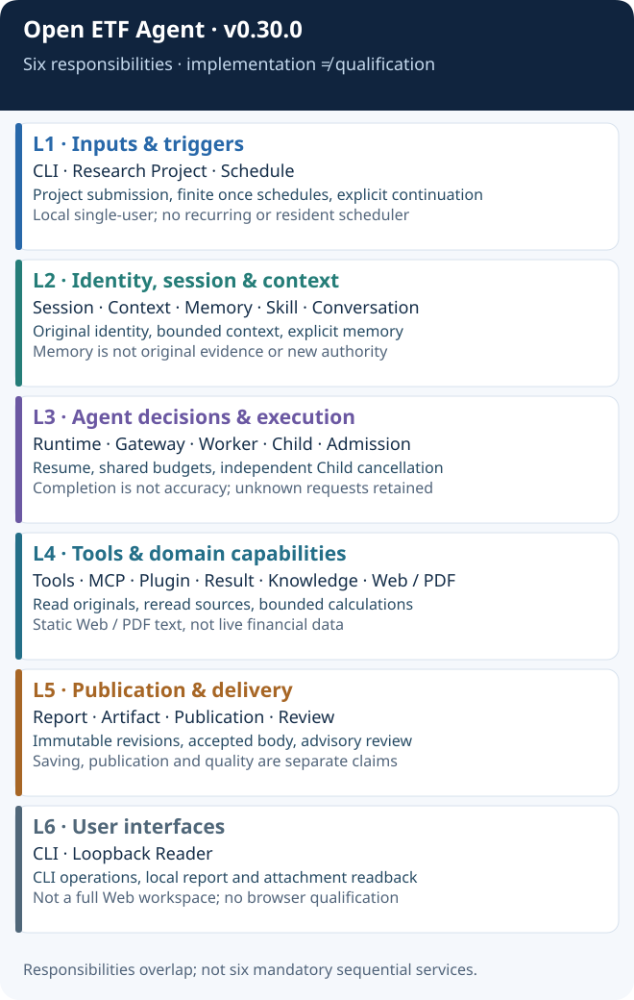
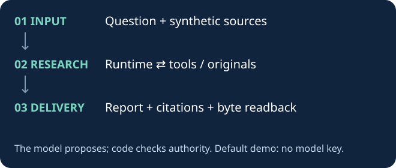

<p align="center"><strong>English</strong> | <a href="README.zh-CN.md">简体中文</a></p>

# Open ETF Agent

<p align="center">
  <a href="https://github.com/hpoenixf/open-etf-agent/actions/workflows/verify.yml?query=branch%3Amain"></a>
  <a href="https://github.com/hpoenixf/open-etf-agent/releases/latest"></a>
  <a href="https://github.com/hpoenixf/open-etf-agent/blob/main/LICENSE"></a>
  <br />
  <a href="https://github.com/hpoenixf/open-etf-agent/blob/main/package.json"></a>
  <a href="https://github.com/hpoenixf/open-etf-agent/blob/main/package.json"></a>
  <a href="https://github.com/hpoenixf/open-etf-agent/stargazers"></a>
</p>
<p align="center">
  <a href="https://hub.xerj.org/contributors/hpoenixf"></a><br />
  <small>The v0.9 standalone CLI Worker implementation was selected for <a href="https://hub.xerj.org/corpus/hpoenixf--open-etf-agent">XERJ Corpus Hub</a>.</small>
</p>


**Read an Agent architecture article. Run its corresponding implementation. Open a report and trace it back to sources, fixed code and evidence.**

A runnable learning project for Agent developers. Start with an offline report over synthetic documents, then explore the modules and evidence. No model key required; not a live fund-research, trading or investment-advice service.

**[Quickstart](#quickstart) · [Read all articles](https://hpoenixf.com/eff-agent-article/en/open-etf-agent)**

[Latest modules](#versions) · [Architecture](#architecture) · [Scope and safety](#scope) · [Full documentation](#documentation) · [Contribute](#feedback-and-contributions)

<!-- module-map:start -->
<a id="module-map"></a>
## What is here, and how far does it go?

[](docs/module-status.md)

**Current map: v0.30.0** · [Modules, source & evidence](docs/module-status.md) · [Six-layer article (Chinese original)](https://github.com/hpoenixf/eff-agent-article/blob/249f0b866f9446f33b57f186fbc6d35b5d82c119/articles/017-prompt-to-answer-six-layer-panorama-v3.md)

This maps public implementation, not completion percentages. Live-model evidence qualifies only the paths in [version records](docs/verification/README.md), not financial accuracy, production or browser experience.
<!-- module-map:end -->

<a id="reading"></a>
## Start with a question, not a version number

<details>
<summary>Choose a reading and hands-on path</summary>

| What you want to do | Read / run next |
| --- | --- |
| Understand one Agent workflow | [Agent in fifteen minutes](https://hpoenixf.com/eff-agent-article/en/articles/agent-in-15-minutes) → [Execution identities](https://hpoenixf.com/eff-agent-article/en/articles/agent-task-session-run-worker-schedule) |
| Research your own documents | [Research project workshop](https://hpoenixf.com/eff-agent-article/en/articles/open-etf-agent-research-project-workshop) → [Project CLI](docs/research-project.md) |
| Gather evidence, delegate and review | [Report review workshop](https://hpoenixf.com/eff-agent-article/en/articles/open-etf-agent-report-review-workshop) → [Specialist profiles](docs/v027-specialist-profiles.md) · [Report review](docs/report-review.md) |
| Check what an article actually implements | [Fixed-version coverage](docs/articles-and-code.md) · [All articles](https://hpoenixf.com/eff-agent-article/en/open-etf-agent) |

Articles can describe a broader system than the public module. Coverage records qualify historical fixed versions, not the full capability set of latest main.

</details>

**Recently updated reading**

<!-- Recent reading source: hpoenixf/eff-agent-article@249f0b866f9446f33b57f186fbc6d35b5d82c119 README.md; Chinese-source Git history order, translated editions are not separate entries. -->
[Subagent Panorama](https://hpoenixf.com/eff-agent-article/en/articles/agent-subagent-context-specialization) · [Start with a Report You Can Read Back](https://hpoenixf.com/eff-agent-article/en/articles/open-etf-agent-v01-first-readable-report) · [Spec-Driven Agent Development](https://hpoenixf.com/eff-agent-article/en/articles/agent-spec-driven-development-panorama)

<a id="quickstart"></a>
## Quickstart

Requires **Node.js 26.8.1–26.x** and npm. Default examples need no model key. Dependency installation may access npm; the installed examples run offline.

```sh
# Clone main for current development; use a release tag for a fixed version
git clone https://github.com/hpoenixf/open-etf-agent.git
cd open-etf-agent

npm ci --ignore-scripts --no-audit --no-fund
npm run build
npm test
npm run demo -- --case document-compare
```

`build` checks and copies native ESM and example data; it is not a TypeScript typecheck. The comparison keeps all four questions. Each Run creates a separate directory under `runs/` with `report.md`, `manifest.json` and `run.jsonl`. The CLI prints the actual directory. Inspect a Run with `node src/cli.mjs --observe runs/<run-id>`, replacing the placeholder with that ID.

[Try seven more mechanism examples →](docs/module-guide.md#try-seven-more-kinds-of-example)

**What should you inspect?** Open `report.md` in the directory printed by the CLI, then trace sources and execution through `manifest.json` and the observe command. A readable report, a completed task and a correct conclusion are different outcomes.

**Ready to use a real model?** Do not add `--live` to the demo command. Use the [research project entry](docs/research-project.md): first import and submit without model calls, then configure your authorized provider and budget. The [report review entry](docs/report-review.md) also distinguishes fixture lifecycle runs from real model judgment.


<a id="versions"></a>
<a id="latest-three-modules"></a>
## Releases and development status

The latest verified formal Release is **[v0.30.0 · Child lifecycle](https://github.com/hpoenixf/open-etf-agent/releases/tag/v0.30.0)**, published from merge commit `8b940515`. Ten independently frozen live-model workflows over synthetic evidence passed; Runtime completion is not answer-quality certification. [Evidence and quality limits](docs/verification/v030-release.md).

| Recent version / status | What it enables | Usage and boundaries |
| --- | --- | --- |
| [v0.30 · Child lifecycle](https://github.com/hpoenixf/open-etf-agent/releases/tag/v0.30.0) | Original-Session spawn/inspect/cancel, immutable observations, source consumption and cold recovery | [Child lifecycle](docs/child-lifecycle.md) |
| [v0.29 · Conversation](https://github.com/hpoenixf/open-etf-agent/releases/tag/v0.29.0) | Explicit Continue, persisted clarification, safe resume/handoff and revocation with original outputs | [Conversation](docs/conversations.md) |
| [v0.28 · Report Review](https://github.com/hpoenixf/open-etf-agent/releases/tag/v0.28.0) | Advisory findings over frozen report/source text; original report and cold readback remain intact | [Report Review](docs/report-review.md) |

[All fixed versions and commands](docs/module-guide.md#versions) · [Version lineage](versions.json) · [All releases](https://github.com/hpoenixf/open-etf-agent/releases) · [Verification records](docs/verification/README.md)

<a id="architecture"></a>
## Architecture: follow one execution path



<details>
<summary>Text execution path</summary>

```text
Question → Runtime ⇄ Gateway
              │ Context: the next bounded input
              ▼
           Tool Host → read / calculate / save
              ├─ ResultStore: original sources and exact references
              └─ Artifact / Revision: report, files and receipts
                       └─ Reader: reopen the delivered bytes
```

</details>

The model proposes; code checks authority and executes. Session, Publication and the single-Run Worker extend this path rather than adding a second executor. Original sources, working notes and explicitly authorized Memory remain separate.

[Owner responsibilities and limitations](docs/module-guide.md#architecture) · [Design evolution](docs/evolution/evidence-index.md)

<a id="scope"></a>
## Scope and safety

- **Use it to learn and reproduce:** local, single-user synthetic examples. Default demos use scripted Gateway fixtures, not live model judgment, real holdings or market data. No trading or investment advice.
- **Read the qualification literally:** `completed` means execution finished; model quality remains unreviewed. Offline tests and CI are not production, security, financial-semantic or live-recovery certification.
- **Keep authority explicit:** trusted Plugins run local JavaScript and are not sandboxed. The PDF parser is not a hostile-file security sandbox; no OCR, visual/table interpretation or active-PDF recovery is offered. Python isolation and broader Web capabilities are not implied by the examples.
- **Respect original identity and effects:** unknown dispatched requests are not automatically retried; host stop is not user cancellation. SQLite fencing does not provide general external exactly-once effects. [Finish or isolate incompatible active Runs before upgrade](docs/upgrade-guide.md).

<a id="live-evidence"></a>
**Qualification is separate from demos:** the [v0.28 real-model review record over fixed synthetic material](docs/verification/v028-release.md) qualifies only its stated Runtime paths and retains judgment limitations. It is not financial accuracy or production certification. Earlier successes, failures and unknowns remain in the [evidence index](docs/verification/README.md).

<a id="live-entry"></a>
**Choose the right execution entry:** the demo CLI rejects `--live`; the project CLI can use an explicitly authorized provider. The [separate validation runner](docs/live-validation.md) is for fixed-input verification, not the default product entry. Other operators' keys, data and cost authorization are not inherited.

<a id="documentation"></a>
## Go deeper

- [Full module commands and version history](docs/module-guide.md)
- [Verification evidence index](docs/verification/README.md)
- [Article-to-code mapping](docs/articles-and-code.md)

<a id="roadmap"></a>
[Roadmap](docs/plan/v1-to-v2.md): planned is not shipped. v0.26 ships explicit public static-page acquisition; broader Web capabilities, isolated Python and richer PDF support remain separate candidates, not bundled promises.

## Author

**By hpoenixf: 10 years of software development experience, including 5 years building financial business systems.** A frontend-leaning full-stack developer focused on Agent engineering, connecting system design with runnable implementations and verification evidence. [Personal blog](https://hpoenixf.com/) · [Engineering articles](https://hpoenixf.com/eff-agent-article/en/)

## License

Original code and accompanying original documentation are [MIT](LICENSE), Copyright © 2026 Huang Pengfei. Third-party dependencies, the accompanying Evidence Kit and NOTICE retain their own licenses and attribution. This license does not cover external private source, manuscripts or other outside content. `private: true` prevents accidental npm publication; it does not restrict MIT rights.

### Feedback and contributions

See the [repository maintenance acceptance requirements](docs/verification/README.md#repository-maintenance).

Open an [issue](https://github.com/hpoenixf/open-etf-agent/issues) with the **stage/commit, Node version, minimal reproduction, expected behavior and actual result**. Do not include keys, private material, databases, real holdings or unsanitized logs. For improvements, explain the concrete problem and how the change can be verified.

<details>
<summary>Older section bookmarks (expand)</summary>

## Moved section links

Existing bookmarks continue to resolve; each link opens its corresponding guide section.

<a id="what-you-can-inspect"></a>
[What you can inspect](docs/module-guide.md#what-you-can-inspect)

<a id="v013--one-durable-ordinary-reply"></a>
[v0.13 · One durable ordinary reply](docs/module-guide.md#v013--one-durable-ordinary-reply)

<a id="v012--fixed-task-time"></a>
[v0.12 · Fixed task time](docs/module-guide.md#v012--fixed-task-time)

<a id="v011-one-local-pdf-one-physical-page-original-bytes-retained"></a>
[v0.11: one local PDF, one physical page, original bytes retained](docs/module-guide.md#v011-one-local-pdf-one-physical-page-original-bytes-retained)

<a id="v010-one-source-selection-one-result-one-report-and-csv"></a>
[v0.10: one source selection, one result, one report and CSV](docs/module-guide.md#v010-one-source-selection-one-result-one-report-and-csv)

<a id="v09-another-process-continues-the-original-run"></a>
[v0.9: another process continues the original Run](docs/module-guide.md#v09-another-process-continues-the-original-run)

<a id="v06-read-download-and-verify-over-real-http"></a>
[v0.6: read, download and verify over real HTTP](docs/module-guide.md#v06-read-download-and-verify-over-real-http)

<a id="v07-trusted-contributions-and-same-run-continuation"></a>
[v0.7: trusted contributions and same-Run continuation](docs/module-guide.md#v07-trusted-contributions-and-same-run-continuation)

<a id="v08-commit-and-read-back-one-answer-block"></a>
[v0.8: commit and read back one answer block](docs/module-guide.md#v08-commit-and-read-back-one-answer-block)

<a id="version-history-ten-fixed-snapshots"></a>
[Complete version history](docs/module-guide.md#versions)

<a id="architecture-keep-responsibilities-visible"></a>
[Architecture: keep responsibilities visible](docs/module-guide.md#architecture-keep-responsibilities-visible)

<a id="evidence-and-its-limits"></a>
[Evidence and its limits](docs/module-guide.md#evidence-and-its-limits)

<a id="real-calls-16-http-requests-not-16-capability-certifications"></a>
[Real calls: 16 HTTP requests, not 16 capability certifications](docs/module-guide.md#real-calls-16-http-requests-not-16-capability-certifications)

<a id="restricted-live-runner-separate-from-the-demo-cli"></a>
[Restricted live runner: separate from the demo CLI](docs/module-guide.md#restricted-live-runner-separate-from-the-demo-cli)

<a id="articles-and-code"></a>
[Articles and code](docs/module-guide.md#articles-and-code)

<a id="roadmap-planned-is-not-shipped"></a>
[Roadmap: planned is not shipped](docs/module-guide.md#roadmap-planned-is-not-shipped)

<a id="english"></a>
[English](docs/module-guide.md#english)

</details>
