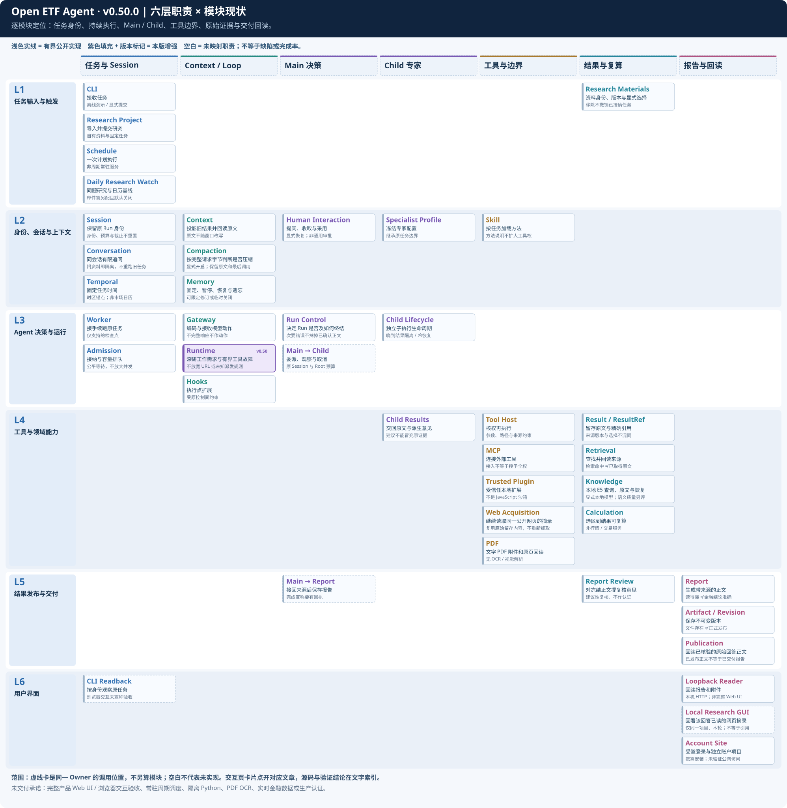
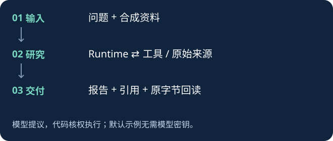

<p align="center"><a href="README.md">English</a> | <strong>简体中文</strong></p>

# Open ETF Agent

<p align="center">
  <a href="https://github.com/hpoenixf/open-etf-agent/actions/workflows/verify.yml?query=branch%3Amain"></a>
  <a href="https://github.com/hpoenixf/open-etf-agent/releases/latest"></a>
  <a href="https://github.com/hpoenixf/open-etf-agent/blob/main/LICENSE"></a>
  <br />
  <a href="https://github.com/hpoenixf/open-etf-agent/blob/main/package.json"></a>
  <a href="https://github.com/hpoenixf/open-etf-agent/blob/main/package.json"></a>
  <a href="https://github.com/hpoenixf/open-etf-agent/stargazers"></a>
</p>
<p align="center">
  <a href="https://hub.xerj.org/contributors/hpoenixf"></a><br />
  <small>v0.9 独立 CLI Worker 实现收录于 <a href="https://hub.xerj.org/corpus/hpoenixf--open-etf-agent">XERJ Corpus Hub</a>。</small>
</p>


**读一篇 Agent 架构文章，运行对应实现，打开一份报告，再追到原始来源、固定代码与验证证据。**

面向 Agent 工程开发者的可运行学习项目。先用离线合成资料生成报告，再按六层地图阅读模块和证据。不需要模型密钥；不是实时基金研究、交易或投资建议服务。

**[快速运行](#quickstart) · [阅读全部文章](https://hpoenixf.com/eff-agent-article/open-etf-agent)**

[最近版本](#versions) · [架构职责](#architecture) · [适用与安全边界](#scope) · [完整资料](#documentation) · [反馈与参与](#反馈与参与) · [微信公众号](#wechat-public-account)

<!-- module-map:start -->
<a id="module-map"></a>
## 现在有哪些模块，做到哪了？

[](docs/assets/module-map.zh-CN.svg)

[交互模块图：逐卡打开文章](https://hpoenixf.com/eff-agent-article/open-etf-agent#module-map) · [打开原尺寸模块矩阵（可放大）](docs/assets/module-map.zh-CN.svg) · [逐模块文字与源码索引](docs/module-status.zh-CN.md)

GitHub 将 SVG 当作一张图片，不能在缩略图里逐卡点击；下表每个模块名直接打开对应文章。

| 职责层 | 模块与能力 → 对应文章 |
| --- | --- |
| L1 任务输入与触发 | [CLI](https://hpoenixf.com/eff-agent-article/articles/agent-in-15-minutes) · [Research Project](https://hpoenixf.com/eff-agent-article/articles/open-etf-agent-research-project-workshop) · [Research Materials](https://hpoenixf.com/eff-agent-article/articles/agent-research-assets-identity-version-lifecycle) · [Schedule](https://hpoenixf.com/eff-agent-article/articles/agent-autonomous-scheduled-research) · [Daily Research Watch](https://hpoenixf.com/eff-agent-article/articles/agent-autonomous-scheduled-research) |
| L2 身份、会话与上下文 | [Session](https://hpoenixf.com/eff-agent-article/articles/agent-task-session-run-worker-schedule) · [Conversation](https://hpoenixf.com/eff-agent-article/articles/agent-conversation-admission-task-continuation) · [Temporal](https://hpoenixf.com/eff-agent-article/articles/agent-temporal-semantics-market-calendar) · [Context](https://hpoenixf.com/eff-agent-article/articles/agent-context-governance-actions) · [Compaction](https://hpoenixf.com/eff-agent-article/articles/agent-main-run-context-compaction) · [Memory](https://hpoenixf.com/eff-agent-article/articles/026-agent-memory-forget-durable-effects) · [Human Interaction](https://hpoenixf.com/eff-agent-article/articles/agent-durable-human-interaction-response-adoption) · [Specialist Profile](https://hpoenixf.com/eff-agent-article/articles/agent-custom-expert-from-prompt-to-recovery) · [Skill](https://hpoenixf.com/eff-agent-article/articles/agent-skill-from-markdown-to-callable-research) |
| L3 Agent 决策与运行 | [Worker](https://hpoenixf.com/eff-agent-article/articles/open-etf-agent-v010-system-design) · [Admission](https://hpoenixf.com/eff-agent-article/articles/agent-provider-admission-capacity-lease) · [Gateway](https://hpoenixf.com/eff-agent-article/articles/agent-provider-architecture-and-admission) · [Runtime](https://hpoenixf.com/eff-agent-article/articles/etf-agent-model-harness-research-loop) · [Hooks](https://hpoenixf.com/eff-agent-article/articles/agent-multi-ecosystem-hook-execution) · [Run Control](https://hpoenixf.com/eff-agent-article/articles/agent-veto-authority-and-run-termination) · [Main → Child](https://hpoenixf.com/eff-agent-article/articles/agent-subagent-context-specialization) · [Child Lifecycle](https://hpoenixf.com/eff-agent-article/articles/agent-subagent-context-specialization) |
| L4 工具与领域能力 | [Tool Host](https://hpoenixf.com/eff-agent-article/articles/agent-tool-lifecycle-and-model-input) · [MCP](https://hpoenixf.com/eff-agent-article/articles/mcp-host-from-discovery-to-consumption) · [Trusted Plugin](https://hpoenixf.com/eff-agent-article/articles/020-agent-extension-host-smartphone) · [Web Acquisition](https://hpoenixf.com/eff-agent-article/articles/021-agent-web-research-from-search-to-deep-reading) · [PDF](https://hpoenixf.com/eff-agent-article/articles/024-agent-pdf-from-text-to-evidence) · [Result / ResultRef](https://hpoenixf.com/eff-agent-article/articles/tool-results-outside-model-context) · [Retrieval](https://hpoenixf.com/eff-agent-article/articles/agent-knowledge-retrieval-end-to-end) · [Knowledge](https://hpoenixf.com/eff-agent-article/articles/agent-knowledge-retrieval-end-to-end) · [Calculation](https://hpoenixf.com/eff-agent-article/articles/open-etf-agent-v010-system-design) · [Child Results](https://hpoenixf.com/eff-agent-article/articles/agent-subagent-contribution-evidence) |
| L5 结果发布与交付 | [Main → Report](https://hpoenixf.com/eff-agent-article/articles/open-etf-agent-v01-first-readable-report) · [Report](https://hpoenixf.com/eff-agent-article/articles/open-etf-agent-v01-first-readable-report) · [Artifact / Revision](https://hpoenixf.com/eff-agent-article/articles/agent-artifact-version-access-sharing) · [Publication](https://hpoenixf.com/eff-agent-article/articles/019-agent-answer-publication) · [Report Review](https://hpoenixf.com/eff-agent-article/articles/open-etf-agent-report-review-workshop) |
| L6 用户界面 | [Loopback Reader](https://hpoenixf.com/eff-agent-article/articles/open-etf-agent-v010-system-design) · [Local Research GUI](https://hpoenixf.com/eff-agent-article/articles/agent-conversation-admission-task-continuation) · [Account Site](https://hpoenixf.com/eff-agent-article/articles/open-etf-agent-v010-system-design) · [CLI Delivery Eval](https://hpoenixf.com/eff-agent-article/articles/open-etf-agent-v01-first-readable-report) · [Portable Report Bundle](https://hpoenixf.com/eff-agent-article/articles/open-etf-agent-v01-first-readable-report) · [ETF Snapshot Compare](https://hpoenixf.com/eff-agent-article/articles/open-etf-agent-v01-first-readable-report) · [Skill Author Preflight](https://hpoenixf.com/eff-agent-article/articles/agent-skill-from-markdown-to-callable-research) · [Self-host Diagnostics](https://hpoenixf.com/eff-agent-article/articles/open-etf-agent-v010-system-design) |

**当前地图: v1.0.3** · [模块、源码与证据](docs/module-status.zh-CN.md) · [六层文章原文](https://github.com/hpoenixf/eff-agent-article/blob/249f0b866f9446f33b57f186fbc6d35b5d82c119/articles/open-etf-agent-v010-system-design.md)

文章关联是阅读导航，不等于实现全文能力或覆盖资格。图中是公开实现范围，不是全功能完成率。真实模型验证只覆盖[各版记录](docs/verification/README.md)中的指定路径；金融语义、生产与浏览器体验不因此获得认证。
<!-- module-map:end -->

<a id="reading"></a>
## 从问题进入，而不是从版本号开始

<details>
<summary>按问题选阅读与练手路径</summary>

| 你想做什么 | 先读 / 先运行 |
| --- | --- |
| 看懂 Agent 的一次工作 | [十五分钟入门](https://hpoenixf.com/eff-agent-article/articles/agent-in-15-minutes) → [运行身份全景](https://hpoenixf.com/eff-agent-article/articles/agent-task-session-run-worker-schedule) |
| 用自己的资料做研究 | [研究项目练手篇](https://hpoenixf.com/eff-agent-article/articles/open-etf-agent-research-project-workshop) → [项目 CLI](docs/research-project.zh-CN.md) |
| 查证、分工，再复核报告 | [报告复核练手篇](https://hpoenixf.com/eff-agent-article/articles/open-etf-agent-report-review-workshop) → [专家配置](docs/v027-specialist-profiles.zh-CN.md) · [报告复核](docs/report-review.zh-CN.md) |
| 核对文章到底实现了什么 | [固定版本覆盖记录](docs/articles-and-code.zh-CN.md) · [全部文章](https://hpoenixf.com/eff-agent-article/open-etf-agent) |

文章讲解的系统可能比公开模块更完整；覆盖记录是固定版本的历史资格，不是最新 main 的能力总表。

</details>

**近期更新的阅读素材**

<!-- Recent reading source: hpoenixf/eff-agent-article@8ed23b7c67c52b15b2696bcdb4580d6df12e11ab README.md; Chinese-source Git history order, translated editions are not separate entries. -->
[从第一次提问到重新打开：用 Open ETF Agent 做一次可回看的研究](https://hpoenixf.com/eff-agent-article/articles/open-etf-agent-verify-and-reopen-research) · [Publication：为什么需要独立发布系统](https://hpoenixf.com/eff-agent-article/articles/019-agent-answer-publication) · [Web：从搜索到连续阅读](https://hpoenixf.com/eff-agent-article/articles/021-agent-web-research-from-search-to-deep-reading)

<a id="quickstart"></a>
## 快速运行 · Quickstart

需要 **Node.js 26.8.1–26.x** 与 npm。默认示例不需要模型密钥；安装依赖可能访问 npm，安装后的示例离线运行。

```sh
# main 是持续演进的开发分支；复现固定版本时使用对应 Release tag
git clone https://github.com/hpoenixf/open-etf-agent.git
cd open-etf-agent

npm ci --ignore-scripts --no-audit --no-fund
npm run build
npm test
npm run demo -- --case document-compare
```

`build` 检查并复制原生 ESM 与示例资料，不是 TypeScript 类型检查。默认比较保留四题完整分母；每次 Run 在 `runs/` 下产生独立目录，包含 `report.md`、`manifest.json` 和 `run.jsonl`。CLI 输出实际运行目录；观察某次运行可使用 `node src/cli.mjs --observe runs/<run-id>`，将占位符换成实际 ID。

[另有 7 个机制示例 →](docs/module-guide.zh-CN.md#继续体验另外七类示例)

**运行后看什么？** 打开 CLI 输出目录里的 `report.md`，再用 `manifest.json` 和观察命令追到来源与执行记录。报告是否可读、任务是否完成、结论是否正确是三个不同问题。

**准备接入真实模型？** 不要给演示命令加 `--live`。使用[研究项目入口](docs/research-project.zh-CN.md)，先完成零模型资料导入与提交，再配置自己已授权的提供方和预算；[报告复核入口](docs/report-review.zh-CN.md)也区分 fixture 生命周期与真实模型判断。


[离线测评：用 CLI 验证正文交付、比较基线](docs/evaluation-cli.md)

<a id="versions"></a>
<a id="最近三个模块"></a>
## 最近版本与开发状态

**[v0.70.0 · 自部署故障诊断](https://github.com/hpoenixf/open-etf-agent/commit/7b7e3a586c8bae962359654247680a2fe3db3e54).** 分别检查依赖、运行版本、配置、目录权限与本地服务。 [范围与验证](docs/verification/v070-self-host-diagnostics.zh-CN.md)

**[v0.69.0 · Skill 开发与预检](https://github.com/hpoenixf/open-etf-agent/commit/1e9f4d300b6dbef5df5ea2262891020acb4bb193).** 校验、预览 Skill，并运行合成测试样例。 [范围与验证](docs/verification/v069-skill-author-preflight.zh-CN.md)

**[v0.68.0 · ETF 快照对比与复算](https://github.com/hpoenixf/open-etf-agent/commit/0d46ab558e64328cc860319e8bc2b995ae5ea4e8).** 用本地快照复算费率差、持仓与行业重叠以及同口径收益。 [范围与验证](docs/verification/v068-etf-snapshot-comparison.zh-CN.md)

| 最近版本 / 状态 | 能做什么 | 用法与边界 |
| --- | --- | --- |
| [v0.70.0 · 自部署故障诊断](https://github.com/hpoenixf/open-etf-agent/commit/7b7e3a586c8bae962359654247680a2fe3db3e54) | 分别检查依赖、运行版本、配置、目录权限与本地服务 | [范围与验证](docs/verification/v070-self-host-diagnostics.zh-CN.md) |
| [v0.69.0 · Skill 开发与预检](https://github.com/hpoenixf/open-etf-agent/commit/1e9f4d300b6dbef5df5ea2262891020acb4bb193) | 校验、预览 Skill，并运行合成测试样例 | [范围与验证](docs/verification/v069-skill-author-preflight.zh-CN.md) |
| [v0.68.0 · ETF 快照对比与复算](https://github.com/hpoenixf/open-etf-agent/commit/0d46ab558e64328cc860319e8bc2b995ae5ea4e8) | 用本地快照复算费率差、持仓与行业重叠以及同口径收益 | [范围与验证](docs/verification/v068-etf-snapshot-comparison.zh-CN.md) |

[全部固定版本与命令](docs/module-guide.zh-CN.md#versions) · [版本谱系](versions.json) · [全部 Release](https://github.com/hpoenixf/open-etf-agent/releases) · [验证记录](docs/verification/README.zh-CN.md)

<details>
<summary>历史版本</summary>

**[v0.67.0 · 离线研究交付包](https://github.com/hpoenixf/open-etf-agent/commit/3e3fa36832f721957c811f111f87d1b50d2918f7).** 导出已发布报告，保留公开引用定位，断网核验全部文件。 [范围与验证](docs/verification/v067-offline-report-bundle.zh-CN.md)

**[v0.51.0 · CLI 离线交付测评](https://github.com/hpoenixf/open-etf-agent/commit/599c512e5220a7d474ad1a021faa87897157ff36).** 四个合成用例核对正文和来源 HTTP 回读，并逐题关联本地 Runtime 时间线。不调用模型、不改 GUI。 [范围与验证](docs/verification/v051-offline-delivery-evaluation.zh-CN.md)

**[v0.50.0 · 每日研究与完整定时邮件](https://github.com/hpoenixf/open-etf-agent/releases/tag/v0.50.0).** 每日追踪按北京时间划分新闻窗口。Owner 可单独确认完整每日摘要或逐条发送早晚报告，邮件不会重复发起研究。邮件默认关闭。 [范围与验证](docs/verification/v050-daily-brief-and-complete-email.md)

**[v0.49.0 · 研究运行时可靠性](https://github.com/hpoenixf/open-etf-agent/releases/tag/v0.49.0).** 深度研究可维护本轮工作需求。经证实的本地 URL 拒绝和已结算的可选网页超时，不必抹掉已经取得的研究材料；URL 许可规则保持不变。工作台观测为可选，默认关闭。 [范围与验证](docs/verification/v049-research-runtime-reliability.md)

**[v0.48.0 · 回看已保存回答的已读网页](https://github.com/hpoenixf/open-etf-agent/releases/tag/v0.48.0)。** 打开已保存回答旁的「已读网页」，可回看本轮实际读取的原文链接和已核验的留存摘录。缺失或无法核验的来源不展示，已保存正文不变。隔离预发验证了刷新后的回读，未重新发起模型请求。 [范围与验证](docs/verification/v048-verified-web-sources.md)

**[v0.46.1 · 紧凑研究工作台](https://github.com/hpoenixf/open-etf-agent/releases/tag/v0.46.1)。** 输入固定在底部，会话与来源分别折叠，每日追踪默认收成胶囊，停止研究移到发送位置。预发检查覆盖桌面和窄视口，本版未重跑付费十题。 [范围与验证](docs/verification/v0461-compact-workbench.zh-CN.md)

**[v0.46.0 · 深度研究证据进度](https://github.com/hpoenixf/open-etf-agent/releases/tag/v0.46.0)。** 深度研究会区分读到原文、检查后未取得可读来源，以及正文已保存并可读回。隔离预发的十个固定任务均完成，正文均原样读回；浏览器验证覆盖一轮显式深度研究。这不代表结论已独立核验，托管正式环境也未变更。 [范围与验证](docs/verification/v046-deep-evidence-milestones.md) · [PR #26](https://github.com/hpoenixf/open-etf-agent/pull/26)

**[v0.45.0 · 研究模式与紧凑输入区](https://github.com/hpoenixf/open-etf-agent/releases/tag/v0.45.0)。** 在同一个输入区选择自动、标准或深度模式，也可点「选工具」指定金融图表 Skill。思考强度独立设置，仅对明确启用的 OpenCode Go GLM-5.3-Flash 路线提供预览；使用默认项不发送覆盖值。隔离预发固定十题运行交付与历史回读均为 10/10，按更严格的发布条件为 9/10。未部署托管正式环境。 [范围与验证](docs/verification/v045-research-intent.md)

**[v0.44.0 · 研究工作台界面](https://github.com/hpoenixf/open-etf-agent/releases/tag/v0.44.0)。** 历史报告以 Markdown 显示，金融图表 Skill 只呈现同一轮研究中经过核验的数据，缺值不填补。默认本地启动仍离线；隔离预发通过桌面和窄视口检查，未验收浏览器 PDF 或真机手机，未部署托管正式环境。[范围与验证](docs/verification/v044-gui-candidate.md)

**[v0.43.0 · 隔离账户工作台](https://github.com/hpoenixf/open-etf-agent/releases/tag/v0.43.0)。** 按需启用受邀账户登录，每个账户使用独立项目，原默认离线工作台不变。正式安装器已通过隔离验收，公网 TLS 和真实数据迁移未验收。[设置与范围](docs/verification/v043-account-site.md)

| 最近版本 / 状态 | 能做什么 | 用法与边界 |
| --- | --- | --- |
| [v0.45.0 · 研究模式与紧凑输入区](https://github.com/hpoenixf/open-etf-agent/releases/tag/v0.45.0) | 三种研究模式、图表 Skill、可选思考强度预览 | [范围与验证](docs/verification/v045-research-intent.md) |
| [v0.44.0 · 研究工作台界面](https://github.com/hpoenixf/open-etf-agent/releases/tag/v0.44.0) | Markdown 报告与同轮图表回读；缺值不填补 | [范围与验证](docs/verification/v044-gui-candidate.md) |
| [v0.43.0 · 隔离账户工作台](https://github.com/hpoenixf/open-etf-agent/releases/tag/v0.43.0) | 受邀登录与独立项目；未验收公网部署 | [设置与范围](docs/verification/v043-account-site.md) |

**[v0.42.0 · 每日研究与可选的持有人摘要](https://github.com/hpoenixf/open-etf-agent/releases/tag/v0.42.0).** 同一问题续用上一份已核实的回答，修改问题后重建基线。邮件需另行启用，未完成外部投递验收。[使用说明](docs/local-gui-daily-watch.md) · [运行验收](docs/verification/v042-runtime-qualification.md)

**[v0.41.0 · 持有人研究工作台](https://github.com/hpoenixf/open-etf-agent/releases/tag/v0.41.0).** 支持同会话有限追问、查看实际研究进度，以及可选公开检索及 Wind 基金日收盘价。默认仍是离线演练。已实现按轮附带文字 PDF，但浏览器 PDF 验收延期。[持有人用法](docs/local-gui-live.md) · [范围与验证](docs/verification/v041-release-candidate.md)

**[v0.39.0 · 本地研究界面预览](https://github.com/hpoenixf/open-etf-agent/releases/tag/v0.39.0)。** 用 `npm run gui -- --project ./test-output/local-gui` 打开浏览器工作台。界面使用内置的两份 ETF 模拟资料，会话、报告和引用保存在本机。[启动方式和适用范围](docs/local-gui.md) · [验收证据](docs/verification/v039-release.md)

**[v0.38.0 · Wind 基金日收盘价](https://github.com/hpoenixf/open-etf-agent/releases/tag/v0.38.0):** 显式查询一只场内基金的未复权日收盘价。默认研究流程不接入 Wind。 [用法](docs/wind-fund-mcp.zh-CN.md) · [证据与边界](docs/verification/v038-release.md).

**[v0.37.0 · Main 上下文压缩](https://github.com/hpoenixf/open-etf-agent/releases/tag/v0.37.0)：** 按完整 Gateway 请求判断压缩；无缩减不重复摘要，最后一个模型调用留给交付。[用法](docs/project-context.zh-CN.md) · [证据与边界](docs/verification/v037-release.md).

**[v0.36.1 维护修复](https://github.com/hpoenixf/open-etf-agent/releases/tag/v0.36.1)。** Main 上下文压缩会把含有结构化项目记忆的已完成工具调用组排除在新摘要和复用摘要之外。原始结构化数据仍走原有的派发前资格核验。[验证与边界](docs/verification/v0361-maintenance.md)

**[v0.36.0 · 项目记忆生命周期](https://github.com/hpoenixf/open-etf-agent/releases/tag/v0.36.0)：** 项目记忆可显式固定、暂停、恢复与遗忘。任务可限定修订或临时禁用记忆；排队后、派发前重新核对资格。固定合成任务真实验收 10/10。[证据与边界](docs/verification/v036-release.md)。

**[v0.35.0 · 原生 PDF 表格证据](https://github.com/hpoenixf/open-etf-agent/releases/tag/v0.35.0)：** 从可识别的原生 PDF 表格按行列引用确切单元格，并从保存的报告回读原页。歧义版面保留纯文本，不猜单元格。冻结真实验收 10/10。[证据与限制](docs/verification/v035-release.md)。

**[v0.34.0 · A14 上下文投影](https://github.com/hpoenixf/open-etf-agent/releases/tag/v0.34.0)：** 可选窗口策略将符合条件的较旧工具结果投影为引用，仍可按同一引用授权回读原文。原始独立测评保持 9/10；针对 Q09 和投影回读的后续验证不改分母。[用法](docs/context-fitting.md) · [证据与限制](docs/verification/v034-release.md)。

**[v0.33.0 · 资料资产生命周期](https://github.com/hpoenixf/open-etf-agent/releases/tag/v0.33.0)：** A17 提供项目内资料版本、幂等导入、替换、移除与显式恢复；历史任务固定原始来源。真实测评首批 8/10 保留，第二批由执行者复核为 9/10，非独立内容验收；两批共 2 条请求费用未知。[证据与限制](docs/verification/v033-release.md)。

**[v0.32.0 · 本地动态 Knowledge](https://github.com/hpoenixf/open-etf-agent/releases/tag/v0.32.0)：** Knowledge 已支持显式本地 E5 动态查询、原子查询与操作预算，以及不重放不确定操作的持久恢复。固定 DeepSeek 4.1 Flash 批次通过 10/10 运行交付和 10/10 严格原文复核；此前内容 8/10 的批次保留。候选召回、证据充分性和最终回答仍分别评估。[动态 Knowledge 用法](docs/dynamic-knowledge.zh-CN.md) · [资格、消耗与边界](docs/verification/v032-release-readiness.zh-CN.md)。

**[v0.31.0 · 本地知识](https://github.com/hpoenixf/open-etf-agent/releases/tag/v0.31.0)** 提供显式文本导入、BM25 自由查询与原始来源回读。独立冻结的真实模型批次完成 9/10 Runtime 工作流；模型指令与正文质量另评。[证据与边界](docs/verification/v031-release.zh-CN.md)。

</details>

<a id="architecture"></a>
## 架构：沿一条执行链理解



<details>
<summary>文字版执行路径</summary>

```text
问题 → Runtime ⇄ Gateway
          │ Context：下一次有界输入
          ▼
       Tool Host → 读取 / 计算 / 保存
          ├─ ResultStore：原始来源与精确引用
          └─ Artifact / Revision：报告、文件与回执
                   └─ Reader：重新打开实际交付字节
```

</details>

模型提出动作，代码检查授权并执行。Session、Publication 与单 Run Worker 接回同一条链，不另造执行器；原始来源、工作笔记与显式授权的 Memory 保持分离。

[完整 Owner 职责与边界](docs/module-guide.zh-CN.md#architecture) · [设计演进记录](docs/evolution/evidence-index.md)

<a id="scope"></a>
## 适用与安全边界

- **适合学习和复现：** 本地、单用户、合成案例。默认演示使用脚本 Gateway fixture，不代表真实模型判断、真实持仓或行情数据；不提供交易执行或投资建议。
- **按实际资格理解：** `completed` 表示执行完成，模型质量仍未评审。离线测试与 CI 不等于生产、安全、金融语义或 live 恢复认证。
- **授权必须显式：** 可信 Plugin 是有本地进程权限的 JavaScript，不是沙箱。PDF 解析器也不是恶意文件安全沙箱；不包含 OCR、视觉/表格理解或活跃 PDF 恢复。示例不暗示已具备 Python 隔离或更广泛 Web 能力。
- **尊重原身份与副作用：** 未知已派发请求不自动重试，宿主停止不等于用户取消；SQLite fence 不提供通用外部恰好一次保证。[升级前完成或隔离不兼容的活跃 Run](docs/upgrade-guide.md)。

<a id="live-evidence"></a>
**真实验收与演示分开：** [v0.31 固定合成材料的 Runtime 记录](docs/verification/v031-release.zh-CN.md)只证明所列 Runtime 路径，保留模型判断局限；不代表金融准确率或生产资格。更早的成功、失败和 unknown 均保留在[历史证据索引](docs/verification/README.zh-CN.md)。

<a id="live-entry"></a>
**选择正确执行入口：** 演示 CLI 拒绝 `--live`，项目 CLI 可以在显式授权后接入真实提供方；[独立验证 runner](docs/live-validation.md)用于固定输入的验证，不是默认产品入口。不要继承别人的密钥、数据或费用授权。

<a id="documentation"></a>
## 完整资料入口

- [全部模块命令与版本历史](docs/module-guide.zh-CN.md)
- [完整验证证据索引](docs/verification/README.zh-CN.md)
- [文章与代码对应关系](docs/articles-and-code.zh-CN.md)

<a id="roadmap"></a>
[完整路线](docs/plan/v1-to-v2.zh-CN.md)：规划不等于交付。v0.26 已提供显式公开静态网页取材；更广泛的 Web 能力、隔离 Python 与更丰富 PDF 支持仍分别评估，不打包作已实现承诺。

## 作者

**作者 hpoenixf：10 年开发经验，5 年金融业务系统研发经验。** 全栈偏前端，关注 Agent 工程实践，把系统设计、可运行实现与验证证据连接起来。 [个人博客](https://hpoenixf.com/) · [工程文集](https://hpoenixf.com/eff-agent-article/)

<a id="wechat-public-account"></a>
### 微信公众号 · 小飞的 AI 投研工坊

扫码关注，在微信里继续阅读 Agent 工程实践。手机端可保存二维码，再在微信中识别。

<a href="docs/assets/wechat-public-account.jpg"></a>

## 许可证

项目原创代码与随附原创文档采用 [MIT](LICENSE)，Copyright © 2026 Huang Pengfei。第三方依赖、随附 Evidence Kit 及其 NOTICE 保留原许可证与归属；本许可不覆盖项目之外的私有源码、书稿或外部内容。`private: true` 仅防止意外发布 npm 包，不限制 MIT 授予的使用权。

### 反馈与参与

参见[仓库维护验收要求](docs/verification/README.zh-CN.md#repository-maintenance)。

欢迎通过 [Issues](https://github.com/hpoenixf/open-etf-agent/issues) 提交问题或讨论。可复现问题请附**阶段/提交、Node 版本、最小步骤、预期与实际结果**；请勿提交密钥、私人资料、数据库、真实持仓或未经清理的原始日志。改进建议优先说明它解决的具体问题，以及如何验证。


<details>
<summary>旧章节精确入口（展开）</summary>

## 旧章节精确入口

保留旧书签；以下每项直接进入指南中的对应章节。

<a id="在这里可以看到什么"></a>
[在这里可以看到什么](docs/module-guide.zh-CN.md#在这里可以看到什么)

<a id="v013--一个持久普通回复"></a>
[v0.13 · 一个持久普通回复](docs/module-guide.zh-CN.md#v013--一个持久普通回复)

<a id="v012--固定任务时间"></a>
[v0.12 · 固定任务时间](docs/module-guide.zh-CN.md#v012--固定任务时间)

<a id="v011一个本地-pdf一张物理页保留原始字节"></a>
[v0.11：一个本地 PDF，一张物理页，保留原始字节](docs/module-guide.zh-CN.md#v011一个本地-pdf一张物理页保留原始字节)

<a id="v010从原始选区到同一份报告与-csv"></a>
[v0.10：从原始选区到同一份报告与 CSV](docs/module-guide.zh-CN.md#v010从原始选区到同一份报告与-csv)

<a id="v09提交退出后由另一进程继续原-run"></a>
[v0.9：提交退出后，由另一进程继续原 Run](docs/module-guide.zh-CN.md#v09提交退出后由另一进程继续原-run)

<a id="v06阅读下载与实际-http-验证"></a>
[v0.6：阅读、下载与实际 HTTP 验证](docs/module-guide.zh-CN.md#v06阅读下载与实际-http-验证)

<a id="v07可信贡献与同一-run-的恢复"></a>
[v0.7：可信贡献与同一 Run 的恢复](docs/module-guide.zh-CN.md#v07可信贡献与同一-run-的恢复)

<a id="v08一个答案块的提交与回读"></a>
[v0.8：一个答案块的提交与回读](docs/module-guide.zh-CN.md#v08一个答案块的提交与回读)

<a id="版本演进--ten-fixed-snapshots"></a>
[完整版本演进](docs/module-guide.zh-CN.md#versions)

<a id="架构职责--keep-the-boundaries-visible"></a>
[架构职责 · Keep the boundaries visible](docs/module-guide.zh-CN.md#架构职责--keep-the-boundaries-visible)

<a id="验证到哪里声明到哪里"></a>
[验证到哪里，声明到哪里](docs/module-guide.zh-CN.md#验证到哪里声明到哪里)

<a id="真实调用记录16-次-http不是-16-次能力认证"></a>
[真实调用记录：16 次 HTTP，不是 16 次能力认证](docs/module-guide.zh-CN.md#真实调用记录16-次-http不是-16-次能力认证)

<a id="受限-live-入口与演示-cli-明确分开"></a>
[受限 live 入口：与演示 CLI 明确分开](docs/module-guide.zh-CN.md#受限-live-入口与演示-cli-明确分开)

<a id="许可证--license"></a>
[许可证 · License](docs/module-guide.zh-CN.md#许可证--license)

<a id="文章与代码"></a>
[文章与代码](docs/module-guide.zh-CN.md#文章与代码)

<a id="后续路线--planned-not-shipped"></a>
[后续路线 · Planned, not shipped](docs/module-guide.zh-CN.md#后续路线--planned-not-shipped)

<a id="english-at-a-glance"></a>
[历史英文概览](docs/module-guide.zh-CN.md#historical-english-overview)

<a id="english"></a>
[English](docs/module-guide.zh-CN.md#english)

</details>
