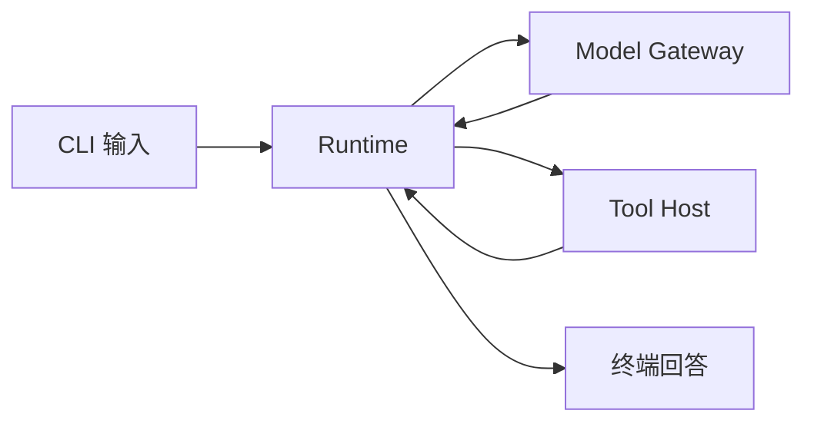
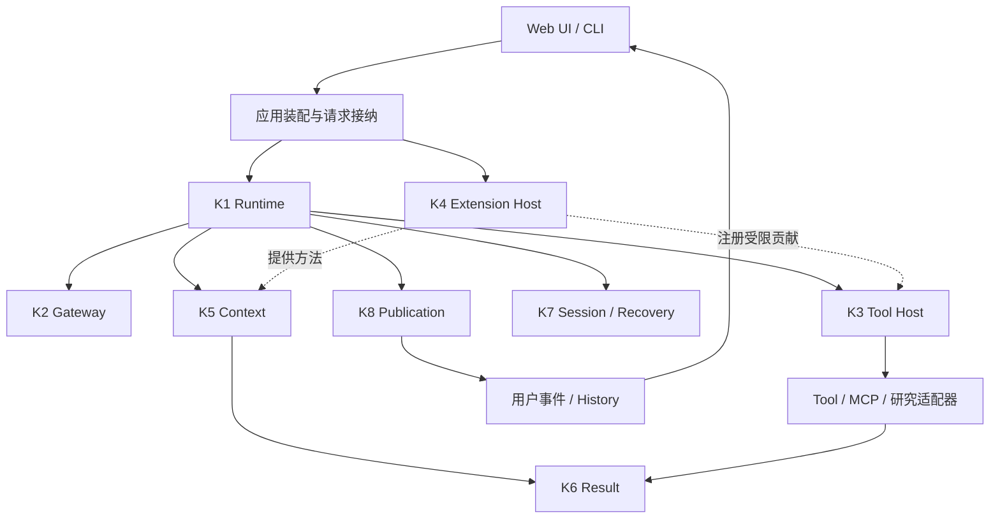
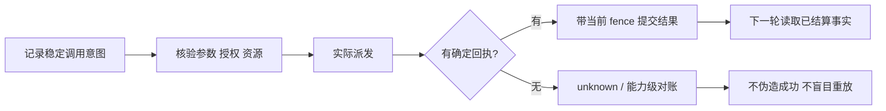

# 03 · 架构、责任与演进契约

> 本文描述目标设计，不要求 v0.1 提前实现所有接口。一个 Module 可以是少量文件；核心数不等于独立 package 数，也不等于全部能力数。

## 1. 从三个核心开始，而不是八个空盒子



v0.1 的三项责任已经足够：决定下一次合法执行步骤、完成一次模型往返、执行一次工具调用。消息装配、工具表和预算可先是局部函数；没有第二种真实变化需求时，不为其建泛化服务。

v0.4 的材料外置使 Context/Result 值得独立；v0.5 的进程故障使持久执行值得独立；v0.6 的多个交付通道使 Publication 值得独立。这是本计划要让读者看见的演进原因。

## 2. 最终八个核心责任模块

| ID | Module / 首次版本 | 自己决定和保存什么 | 明确不拥有 |
| --- | --- | --- | --- |
| K1 | Runtime / v0.1 | 原 Run 的执行生命周期、下一合法步骤、取消、根资源计数与结束 | 研究语义真值、工具业务效果、正文最终可见性 |
| K2 | Model Gateway / v0.1 | 实际模型请求绑定、协议组装、发送与响应完整性 | 新权限、额外预算、Provider 内部推理事实 |
| K3 | Tool Host / v0.1 | 已绑定工具调用的参数检查、派发、实际回执和局部失败 | 来源语义、Child 总终态、全局发布批准 |
| K4 | Extension Host / v0.3 | 可信贡献的注册、激活、版本绑定、释放与 Hook 局部执行 | 每项能力的业务事实、万能副作用事务 |
| K5 | Context / v0.4 | 下一模型回合的受控材料投影与容量拟合 | 修改原始结果、自动新增授权、记忆真值 |
| K6 | Research Result / v0.4 | 结果/来源身份、版本、窗口、派生关系和引用读取 | 证明结论正确、替代调用回执 |
| K7 | Session & Recovery / v0.5 | 持久身份、调用/执行游标、claim/fence、回放协调 | 按内容重新研究、重签工具成功、替每个扩展解释业务状态 |
| K8 | Publication / v0.6 | 正文候选、预览、提交修订及发布回执 | 文件字节真值、浏览器已读、金融正确性 |

K1 的资源政策不是独立预算平台；最初用小对象和计数器，持久化后消费原存储事务。K7 组织恢复，但不成为包含 Memory、Child、Publication 等全部内部类型的总管。八项是当前规划的责任分组，若实现表明某项可更深地合并，应通过设计评审调整，不为维持数字制造转发层。

## 3. 核心之外的能力如何接入

| 能力 | 接入 Seam | 真实事实的持有者 |
| --- | --- | --- |
| Skill | 方法目录＋按需读取 Tool＋Context 输入 | Skill 内容/版本由适配器提供；Host 管读取；Context 管使用 |
| MCP | 工具描述/执行 Adapter | SDK 管协议；Tool Host 管实际调用与授权 |
| Plugin/Hook | K4 注册与局部回调 | 注册生命周期归 K4，工具结果仍归 K3/K6 |
| RAG | 资料查询与原文读取 Tool | 资料/结果模块；检索分数不认证来源充分性 |
| HTTP/CLI | Run 接纳与用户事件读取 | 入口确定请求/主体身份，不另建 Runtime |
| Artifact | 受限文件保存/读取 Adapter | 文件服务拥有字节、哈希与访问身份，Publication 只引用 |
| Child | 可嵌入 Runtime＋根资源服务＋交接包 | Child 拥有局部执行，Root 拥有授权上限与总资源 |
| Worker | 持久任务领取与驱动入口 | K7 保有 claim/fence，Worker 不能绕开其提交条件 |
| Compaction | Context 的已结算区间与摘要采纳 | 压缩能力拥有候选和采纳记录，K6 保留原材料 |
| Memory | 显式记忆命令＋Context 输入 | 记忆能力拥有版本和撤回，不能改投资事实 |
| Web/PDF/Python | Tool 与 Result/Artifact 接口 | 各 Adapter 管真实读取/执行，K6 记录派生谱系 |
| Observe/Evaluate | 只读记录与发布结果查询 | 不获得 Run、权限或发布的决定权 |

适配器和扩展中依然存在实际 Module，不能为了宣传“八个模块”把所有复杂度藏在 extensions 文件夹里。评审同时记录核心变化和扩展自己的复杂度。

## 4. 依赖方向



图描述依赖与交接，不是严格的调用栈或六个进程。SQLite、模型 SDK、MCP SDK、文件系统和容器都是在装配层选择的具体 Adapter。核心不能 import Web 前端、某个 ETF 数据源、某个 MCP SDK 的具体 client 或某个 PDF 解析器。

公开扩展只访问公开窄接口；不允许导入 `core/**/internal` 或持有一个能任意 mutate Runtime 的对象。共享类型只放跨真实接口的最小契约，不能建设一个随每项功能膨胀的 `common.ts`。

### 目标目录（按期生长，不预创建）

```text
src/
  core/
    runtime/       # v0.1；最初可用同名文件
    model/
    tools/
    extensions/    # v0.3
    context/       # v0.4
    results/
    session/       # v0.5
    publication/   # v0.6
  adapters/
    skills/ mcp/ sqlite/ artifacts/ web/ pdf/ python/
  features/
    children/ background/ compaction/ memory/
  app/             # CLI / HTTP / composition
  public-api.ts    # 稳定前小步演进，v1.0才承诺公开面
web/               # v0.6才出现
examples/
  document-compare/
  synthetic-etf/
fixtures/
tests/
docs/evolution/
```

默认一个 npm package。只有真正出现独立分发需求才拆 workspace/package，不因目录多就做多包发布。

## 5. 身份逐期引入

| 版本 | 必需身份 | 不得偷换 |
| --- | --- | --- |
| v0.1 | runId、modelAttemptId、toolCallId | 数组位置或工具名称不能代替调用身份 |
| v0.2—v0.3 | Skill/服务/扩展版本绑定 | 新包内容不能悄悄替换运行中旧绑定 |
| v0.4 | resultId、sourceId/version、locator、citationId | 摘要不能成为原文；新抓取不能改旧来源版本 |
| v0.5 | checkpointVersion、effectId、leaseOwner、fence、schemaVersion | 日志不等于可重放的执行凭据 |
| v0.6 | conversationId、messageId、publicationId/revision、eventId、artifactId | 已生成、已提交、已推送、已显示是不同事实 |
| v0.7 | rootRunId、childId、handoffId | Child 完成不等于 Root 完成 |
| v0.8 | segmentId、memoryId/revision、forget 标记 | 压缩成功不等于证据真实，偏好不是授权 |

不能为了 schema 统一而让 v0.1 所有对象都携带十几个未来字段。字段随行为引入，并在对应版本演进说明解释旧结构如何被替换。

## 6. 三类记录必须分开

**执行事实**：模型实际发送、工具派发与回执、预算消耗、claim/fence。用于 Runtime 和恢复。

**研究材料**：原始数据、读取窗口、计算结果、Child 交接、派生摘要。用于模型理解及可核对引用。

**用户交付**：获准预览、已提交正文、附件引用、用户事件。用于界面和 History。

三者可以共用一个数据库事务设施，但不能用同一个未经区分的事件数组既恢复工具、又给模型、又直接推到浏览器。观测是它们的只读投影，不是第四套事实账本。

## 7. 有副作用后的提交协议



派发记录与外部系统效果不存在普遍原子性。已经提交的回执可以复用；没有回执不等于没有执行。只读工具允许重试时也要记录新 attempt 与取得时间，不能把新结果重新签发为旧观察。写工具需要业务幂等键或对账；本计划默认不开放金融写入。

同一 Run 使用原授权快照。配置更新只影响新 Run；本项目 v1.0 不实现完整的动态撤权传播。需要立即阻止原 Run 时使用明确取消并拒绝后续派发，不能让恢复逻辑悄悄扩大权限。账户安全事件和多组织授权不在支持范围内。

## 8. 公开扩展面的最小方向

以下是概念示意，不是当前可编译 API，也不是要求 v0.1 实现的抽象：

```ts
// 概念示意：每项依赖都有窄接口，不向扩展暴露整个 Runtime。
registerTool(descriptor, executeBoundCall);
registerSkill(metadata, readApprovedResource);
registerHook(event, scopedCallback);
startRun(input, admittedCapabilities);
readResult(resultRef, permittedWindow);
readPublication(runId, revision);
```

v0.3 的扩展 API 在 0.x 阶段允许有说明的破坏性修订；需要同步改示例并在版本差异中解释。v1.0 只冻结已经出现两个真实消费者、且能通过公开入口完成接入的面。仅为一个实现创建的 Adapter 要继续接受“是否必要”的检验。

## 9. 简洁性与维护性验收

每个版本除了功能演示，还要回答三个问题：新增能力改到了哪些非本能力模块，原因是什么；哪些旧代码/旧接口已删除；移除这项扩展后默认 demo 是否仍能运行。

新增能力在首次出现时修改核心接口并不自动是坏设计。但如果成熟扩展每次升级仍反复修改 Runtime、Context、Recovery、Publication 的内部逻辑，就应停下来修正 Seam，而不是继续复制特殊分支。

不设机械的代码行数合格线，不制造第二套复杂度评分平台。使用实际 diff、依赖检查和一个增删扩展示例解释局部性；构造更少但更深的 Module，而不是更多薄转发层。
