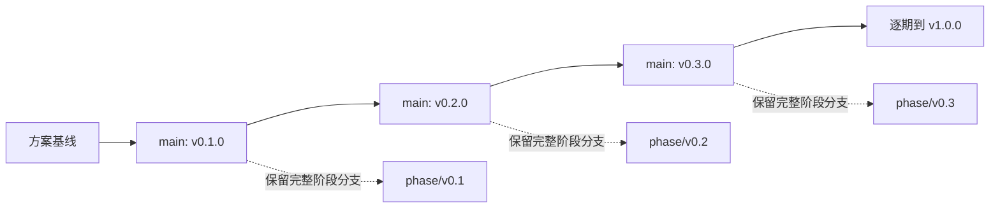

# 04 · 一期一个分支，每个版本独立运行

> 本文是分支与发布政策提案。当前方案 PR 不创建未来阶段分支、标签、GitHub Release 或运行代码；下列命令仅在对应版本实际完成后使用。

## 1. 分支与标签的职责

| 名称 | 责任 | 更新规则 |
| --- | --- | --- |
| `main` | 最近一个已验收阶段，以及经评审的文档/修复 | 不合入下一期半成品，文档修改不冒充新版本发布 |
| `phase/v0.1` … `phase/v1.0` | 该阶段完整代码与演进说明；开发时是工作分支，发布后保留 | 发布后冻结功能，只接该 minor 版本的必要修复 |
| `v0.1.0` … `v1.0.0` | 某次已经验证的精确发布点 | 本项目禁止移动、覆盖或删除已发布标签 |
| `fix/v0.1-<topic>` | 已发布旧版的短期必要修复 | 合回对应 phase 分支，发布新的 patch 标签 |
| `docs/<topic>` | 文档提案 | 不代表运行版本存在；本次 PR 属于此类 |

一个 minor 阶段不是一套永久独立产品。下一期从上一已验收主线继续开发，保留祖先关系与成熟能力，不复制一份仓库重新开始。



图只示意发布点，不表示已经创建这些 Git 对象。Git 分支本身会移动，标签也可被有权限的人修改；“不移动发布标签”是维护纪律和可配置的保护规则，不是技术上天然不可变。

## 2. 一期的标准流程

1. 从当前已验收的 `main` 创建本期 `phase/vX.Y`，记录前一发布标签。`main` 与前一标签之间若有修复/文档差异，先读 diff 并明确纳入基线。
2. 在本期分支完成实现与文档。较大任务可用临时 topic 分支合入 phase，但不提前合入 main。开发中允许未完成状态，不能标记为已发布版本。
3. 运行本期与累计必要验证，固定候选 SHA，生成范围声明与证据索引。失败修复后测试最后的候选，而不是把不同 SHA 的通过记录拼起来。
4. 创建 `phase/vX.Y -> main` 的阶段 PR，展示新增行为、删除路径、边界、迁移与验证。使用保留祖先关系的合并方式；不要把整个教学历史压成不可追踪的复制。
5. 在实际合并结果上复核 build、默认 demo、关键兼容检查。通过后对该精确提交创建带说明的 `vX.Y.0` 标签与发布记录。
6. 将本期 phase 分支快进至该已发布提交并保留。需要非快进时先核对原因，不强推覆盖历史。
7. 下一期从这一已验收主线开始；本期文章绑定标签或完整 SHA，不绑定可移动的 main。

本次方案 PR 只完成准备阶段。不得在代码不存在时预打十个标签来营造“每个版本都能跑”的外观。

## 3. “独立可运行”的准确含义

任一已发布标签都包含自己的源码、测试、fixture、配置示例、依赖锁文件、环境约束和运行说明。它不得依赖：

- 私有 ETF Agent 仓库、书稿目录、私人 npm 包、个人机器上的文件或真实持仓。
- 另一个版本分支的源码、相邻 worktree、Git submodule 或指向最新 main 的运行时下载。
- 未授权的账号或隐藏付费服务；默认 demo 使用 fixture 和模型替身。
- 先执行上一版本的数据迁移才能完成全新安装。

“离线 demo”指依赖和必要镜像已经安装之后，可以不访问外部模型或网站完成演示；不把 `npm ci` 首次下载依赖说成无需网络。research profile 的首次镜像拉取与运行时网络政策分别说明。

至少提供三类入口：

| 类型 | 承诺 |
| --- | --- |
| 默认 deterministic demo | 无模型密钥；同一 Runtime；输入与期望可核对 |
| 显式 live 入口 | 用户配置模型后运行；不静默切回替身；费用与外发资料有提示 |
| 本期测试 | 不需要私人环境；从该标签本身安装和执行 |

涉及 Web/PDF/Python 的版本另列 research profile，不让可选环境阻塞基础 demo，也不把 profile 被跳过算作 profile 验收通过。

## 4. 稳定命令与可读输出

从 v0.1 起优先维持 `npm ci`、`npm run build`、`npm test`、`npm run demo -- --case document-compare` 的外层入口。内部文件组织允许演进，读者不必每期重新记一套基本用法。

新能力才增加新命令：v0.5 的 inspect/resume/cancel，v0.6 的 web，v0.7 的 background，v0.8 的 memory，v1.0 的 observe/evaluate。没有实现的命令不能返回看似成功的占位输出。

Demo 输出应包含当前代码版本、模型模式（fixture/live）、任务名、支持范围和结果位置。不要泄露密钥、绝对私人路径或未经授权的模型载荷。

### 两个版本并排运行（发布后示例）

```bash
# 以下标签需已经真实发布；本方案 PR 当前不能执行这些版本。
git fetch origin --tags
git worktree add --detach ../open-etf-agent-v01 v0.1.0
git worktree add --detach ../open-etf-agent-v02 v0.2.0

cd ../open-etf-agent-v01
npm ci
npm run build
npm run demo -- --case document-compare

cd ../open-etf-agent-v02
npm ci
npm run build
npm run demo -- --case document-compare
npm run demo -- --case skill-mcp
```

相邻版本的教学 diff 以完整标签比较：`git diff v0.1.0..v0.2.0 -- src examples tests docs/evolution`。文章同时提供“共同案例”与“本期新案例”，避免仅比较两个不同任务。

## 5. 环境锁定与长期复现

选择实现时仍受支持的 Node LTS，并在该版本写入 `.node-version`、`engines` 与 lockfile。TypeScript、Schema 校验库、MCP SDK、PDF 解析器和容器镜像都在引入当期核对并固定；不从旧文章照抄版本数字。

发布证据记录实际 Node/npm/操作系统、依赖锁摘要和可选镜像摘要。历史标签不会跟随“最新 Node”持续改写。必要时发布 patch 修复安装问题，并保留原标签。

锁版本不能保证外部注册表永久可用。许可允许时可保留构建产物/镜像摘要与安装说明；缺少环境或外部服务时明确列为不可复现的条件，不能重新录制替身结果替代原 live 记录。

## 6. 状态与数据迁移

v0.1—v0.4 没有跨进程状态兼容承诺。v0.5 起，每个工作目录使用独立 state root，默认带当前 schema/version 范围；不同 worktree 不能自动共享相同数据库。

新版本必须能在空目录独立运行。升级旧数据另设显式命令：先备份、检查 schema 与能力版本，再迁移；禁止自动清库、自动使用上级目录配置，或把不认识的 checkpoint 猜成当前结构。

支持相邻版本数据升级时，测试内容至少包括原回执、结果引用、授权范围、预算、正文和取消标记不被重签。迁移之前的快照可以导出供查阅；不要求所有活跃 Run 跨所有版本热升级。无法安全迁移时只读保留旧记录，并使用旧版恢复或新建任务。

回滚代码不等于回滚数据库。旧版只读不支持的新 schema 时必须拒绝；回滚使用已保存备份和对应代码，不能设计一个未经验证的自动降级迁移。

## 7. 旧版维护政策

维护重点是最新主线和可复现的历史教学快照，不承诺为十个版本长期同步全部新功能。旧版只接安全、阻止安装/运行的缺陷及明显错误示例的修复。

修复从旧版标签建立 fix 分支，回归后更新对应 phase 分支，发布 `v0.1.1` 等新标签；需要时把同类修复向前应用到 main。原文章可以注明 patch 建议，但原 `v0.1.0` 仍可被准确定位。禁止把 main 整体合入旧版，导致它失去教学边界。

发现旧版危险能力时优先禁用受影响默认路径、说明已知风险并提供修复版本，而非因为“教学历史”保留危险默认设置。

## 8. 每期随附的演进包

每个发布版本自身应带：

- `docs/evolution/vX.Y.md`：上一版遇到的实际问题、增加的能力、被替换/删除的路径、当前调用图。
- `docs/evolution/vX.Y-scope.md`：支持/不支持项、准确命令与 fixture、成熟来源说明及本版本验证。
- `docs/evolution/vX.Y-verification.md`：候选 SHA、环境、检查结果、真实调用范围、失败与未评审内容。
- 更新后的 README、配置示例和案例输入/期望。以上文件只在该期实施时创建，不在本次方案中生成十套空证据。

可在实现时加入 `release-manifest.json` 记录当前版本、schema、能力与环境；字段从真实发布过程产生，不能把本方案的 `versions.json` 当作已发布清单。
